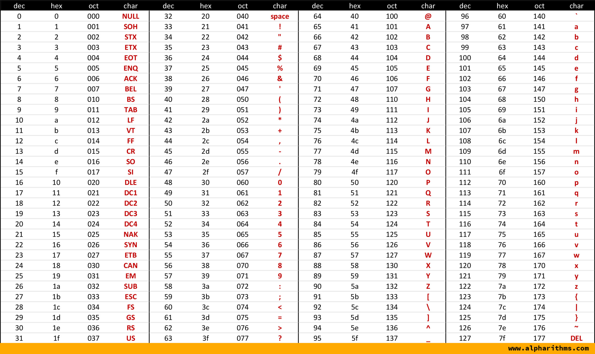

<h2 align=center>Lecture X</h2>

<h1 align=center>Manipulating Strings and String Formatting</h1>

<h3 align=center>15 de Vendémiaire, de l'Année CCXXXV de la République</h3>

<p align=center><strong><em>Song of the day</strong>: <a href="https://youtu.be/hZOUXO0pMN4"><strong><u>Red</u></strong></a> by Bob Junior X Hot Flash Heat Wave (2025).</em></p>

0. [**Character Representation (Continued)**](#part-0-character-representation-continued)
1. [**String Traversal (Continued)**](#part-1-string-traversal-continued)
2. [**The `str` Object**](#part-2-the-str-object)
3. [**String Operations**](#part-3-string-operations)
4. [**String Formatting**](#part-4-string-formatting)
5. [**Practice Problems**](#part-5-practice-problems)

### Part 0: _Character Representation (Continued)_

Recall our conversation on the ASCII table:




<sub>**Figure 1**: ASCII Table ([**Source**](https://www.alpharithms.com/ascii-table-512119/)). </sub>

ASCII stands for _American Standard Code for Information Interchange_, and is a means of encoding characters for digital
communications. It was originally developed in the early 1960s as early networked communications were being developed.

Strangely, this table was developed to encode characters in 7-bits, so its largest value is (1111111)<sub>2</sub>, 
or (127)<sub>10</sub>, which gives us 128 characters in total (0 through 127).

Now, as a good number of us are not from Anglophone countries, this table will seem restrictive—and it is. Romance 
and other Germanic languages contain a good number of accent marks, for instance (e.g. `señal`, `coração`, `straße`).
Even worse, billions of people don't use a Latin-based alphabet in daily communication—the 
[**cyrillic**](https://en.wikipedia.org/wiki/Cyrillic_script#Letters) and 
[**Greek**](https://en.wikipedia.org/wiki/Greek_alphabet#Letters) alphabets, syllabaries like the ingenious Korean
[**hangul**](https://en.wikipedia.org/wiki/Hangul), let alone the topographic 
[**hànzì, kanji, and hanja**](https://en.wikipedia.org/wiki/Chinese_family_of_scripts) of China, Japan, and Korea, are
completely ignored.

Now, of course, we have what is known as [**unicode**](https://en.wikipedia.org/wiki/Unicode), which can encode 
characters in 8-, 16-, and even 32-bits to accommodate to these important sets of characters.

---

So how do we use this information in Python—and what is it good for?

To find out a character's ASCII equivalent, we use the `ord()`, or **ordinal**, function:

```python
>>> ord("a")
97

>>> ord("A")
65

>>> ord("ñ")
241

>>> ord("疲")
30130

>>> ord("δ")
948
```

And, conversely, to find the corresponding character to any given positive integer, we use `chr()`:

```python
>>> chr(123)
'{'

>>> chr(42)
'*'

>>> chr(512)
'Ȁ'
```

### Part 1: _String Traversal (Continued)_

Let's continue our conversation on strings with a quick program. Write a program that asks the user for two strings 
`first_string` and `second_string`. Then, your program will print all the characters from the first string that appear 
in the second string. Write three versions of this program:

1. Using `for`-loop string sequencing.
2. Using `for`-loop string indexing.
3. Using string indexing, but with a `while`-loop.

Here's a sample
output of how your program could behave:

```text
Enter a string: Rickenbacker 4000C Bass Guitar
Enter a second string: Rickenbacker 330 Electric Guitar
R
i
c
k
e
n
b
a
c
k
e
r
 
0
 
e
c
t
r
i
c
 
G
u
i
t
a
r
```

There are two ways we could approach this. The quickest and perhaps more intuitive one is to use the second string as a
sequence, and then check for membership of each of its letters in the first string. We do this by using `in`, the 
membership operator:

```python
first_string = input("Enter a string: ")
second_string = input("Enter a second string: ")

for letter in second_string:
    if letter in first_string:
        print(letter)
```

<sub>**Code block 1**: Checking for membership by treating `second_string` as a sequence.</sub>

If we didn't want to use `second_string` as a sequence, and instead wanted to use indices, our `for`-loop would look 
something like this instead:

```python
first_string = input("Enter a string: ")
second_string = input("Enter a second string: ")

second_string_length = len(second_string)

for index in range(second_string_length):
    letter = second_string[index]
    if letter in first_string:
        print(letter)
```

<sub>**Code block 2**: Checking for membership by using indices. Note the use of `len()`.</sub>

Both ways work and are actually equally efficient. Which one to use depends largely on your use case. If you need to 
know, use, or keep track of the position of an element within a sequence (e.g. _"Find the x-th element of the string"_),
then using indices is the way to go.

Finally, the `while`-loop version will look as follows:

```python
first_string = input("Enter a string: ")
second_string = input("Enter a second string: ")

second_string_length = len(second_string)
index = 0

while index < second_string_length:
    letter = second_string[index]
    if letter in first_string:
        print(letter)

    index += 1
```

Check out the code here [**membership.py**](membership.py) with the configuration `Membership`.

### Part 2: _The `str` Object_

We've been spending a fair amount of time using strings now, so we should probably dive in a little deeper into their 
behavior.

Objects in general (not just `str` objects) have a set of values and operations associated to them. In technical jargon,
we would say that objects have **reference attributes bound to them**. The values associated with objects are called
**attributes** (similar to variables), and the operations associated with objects are called **methods** (similar to 
functions):

> **Attribute**: A _variable_ associated to an object of a certain type/class.
> 
> **Method**: A _function_ associated to an object of a certain type/class.

Both of these terms will make more sense when we get to object-oriented programming, but just learn to recognise this
behavior when I say things like "this is a _method_ of a `str` object", for example.

Let's take a look at some examples:

```python
>>> string = "the tale of the heike"
>>> string.__doc__
"str(object='') -> str\nstr(bytes_or_buffer[, encoding[, errors]]) -> str\n\nCreate a new string object from the given object. If encoding or\nerrors is specified, then the object must expose a data buffer\nthat will be decoded using the given encoding and error handler.\nOtherwise, returns the result of object.__str__() (if defined)\nor repr(object).\nencoding defaults to sys.getdefaultencoding().\nerrors defaults to 'strict'."
>>> string.__class__
<class 'str'>
```

In this case, `__doc__` is an **attribute** associated to the string object `string`, which prints out a bunch of 
technical information that you don't need to worry about. `__class__` is another such attribute, which tells us the name
of the class of the current object (in this case, it's a `str` object).

Let's take a look now at a couple of **methods**:

```python
>>> string = "the tale of the heike"
>>> string.capitalize()
'The tale of the heike'
>>> string.upper()
'THE TALE OF THE HEIKE'
```

In this case, `capitalize()` ***returns*** a string with its first character capitalized (if the first character is
not a lower-case letter, it will simply return the same string). By the same token, `upper()` ***returns*** a string
with the original string's letters capitalized.

This is important. **Strings are immutable**; none of their methods that appear to be mutating them in any way, but 
rather creating an entirely new string object based on the contents of the original:

```python
>>> example = "Mineral water"
>>> example.upper()
'MINERAL WATER'
>>> example
'Mineral water'
>>> example_upper = example.upper()
>>> example_upper
'MINERAL WATER'
```

The value of example didn't change when its `upper()` method was invoked.

Here are some examples of methods from the `str` class that we'll be making heavy use of in this class:

| **Method**  | **Example**                                                                                                                | **Description**                                                                            |
|-------------|----------------------------------------------------------------------------------------------------------------------------|--------------------------------------------------------------------------------------------|
| `find()`    | `"abc".find("a")` returns `0` `"abc".find("z")` returns `-1`                                                               | Returns the index of **first** occurrence of the argument in a string object.              |
| `format()`  | `"Hi, my name is {}, and I love {}.".format("Sebastian", "Zelda")` returns `"Hi, my name is Sebastian, and I love Zelda."` | Formats string into nicer output (see [**Part 4**](#part-4-string-formatting)).            |
| `isalnum()` | `"1978".isalnum()` returns `True` `"The 1975".isalnum()` returns `False`                                                   | Returns `True` if all the characters in a `str` object are alphanumeric.                   |
| `isalpha()` | `"1978".isalpha()` returns `False`  `"TheNineteenSeventyFive".isalpha()` returns `True`                                    | Returns `True` if all the characters in a `str` object are alphabetic.                     |
| `isdigit()` | `"1978".isdigit()` returns `True` `"The1975".isdigit()` returns `False`                                                    | Returns `True` if all the characters in a `str` object are numeric.                        |
| `islower()` | `"The The".islower()` returns `False`                                                                                      | Returns `True` if all the characters in a `str` object are lowercase.                      |
| `isupper()` | `"NYU".isupper()` returns `True`                                                                                           | Returns `True` if all the characters in a `str` object are uppercase.                      |
| `lower()`   | `"Liz and The Blue Bird.".lower()` returns `"liz and the blue bird."`                                                      | Returns a `str` object with all uppercase characters from the original string lower-cased. |
| `upper()`   | `"Liz and The Blue Bird.".upper()` returns `"LIZ AND THE BLUE BIRD."`                                                      | Returns a `str` object with all lowercase characters from the original string upper-cased. |

_**Figure 1**: Some useful `str` methods in this class 
([**Full list**](https://docs.python.org/3/library/stdtypes.html#string-methods))._

There are obviously...a lot of them. But you don't have to memorize all of them. They're all pretty intuitive and self-
explanatory, so it's actually really easy to remember them.

**NOTE**: You may ***not*** yet use `split()` or any other method that returns a `str` object into a `list` object or
any other object that we haven't seen yet. This will be penalized in homework, so please always ask if you are unsure
whether you are allowed to use something or not.

### Part 3: _String Operations_

#### _Concatenation_

Okay, so if you can't modify strings, but your program requires you to put a bunch of strings together, what do we do?

Python makes this extremely easy for us, actually. We can quite literally add two strings together by using the `+` 
operator. This process is called **string concatenation**:

```python
first_name = "Camille"
last_name = "Pissarro"
full_name = first_name + " " + last_name

print(full_name)
```
Output:
```commandline
Camille Pissarro
```

Nothing we haven't seen before. We just have a name for it now. Again, remember neither `first_name` nor `last_name` are
being modified in any way here. All Python is doing here is extracting the contents of `first_name` and `last_name` and
creating a completely new string out of them, `full_name`.

What about this example?

```python
first_name = "Camille"
last_name = "Pissarro"
full_name = first_name + " " + last_name
age = 73
full_info = full_name + ", " + age

print(full_info)
```

Output:

```commandline
Traceback (most recent call last):
  File "<input>", line 5, in <module>
TypeError: can only concatenate str (not "int") to str
```

Ah-hah. We've seen this error before. You cannot concatenate a `str` and an `int`. So if you want to create a new string
from these components, you have to **explicitly convert all non-`str` components into `str` objects**:

```python
first_name = "Camille"
last_name = "Pissarro"
full_name = first_name + " " + last_name
age = 73
full_info = full_name + ", " + str(age)

print(full_info)
```

Output:

```commandline
Camille Pissarro, 73
```

We didn't have to do this when we were composing `print()` statements because `print()` takes care of the type 
conversions for us. But more often than not, we will not be able to rely on `print()` so it's important to know how to
do it yourself.

#### _Slicing_

The second important operation that we can do with strings is _slicing_ them—that is, extracting a specified subsection.

We, of course, already learned how to index a string, which is technically a form of slicing:

```python
>>> "Ahmad Jamal"[4]
'd'
```

But, just like with the `range()` function, we have the power to define our starting, ending, and stepping value using
the following syntax:

```python
string[start:stop:step]
```

As with `range()`, `start` is inclusive and `stop` is **not**. Omitting `step` defaults it to `1`:

```python
>>> "Ahmad Jamal"[2:7]
'mad J'
```

And here, we start at index `2` and take every second character until the end of the string:

```python
>>> jazz_musician = "Ahmad Jamal"
>>> jazz_musician[2:len(jazz_musician):2]
'mdJml'
```

---

### Part 4: _String Formatting_

Concatenation works, but you may have noticed how clunky it gets once a string needs more than a couple of pieces—every
non-`str` value has to be wrapped in `str()`, and it's very easy to lose track of a stray `" "` or `+`. So far, we have
had two ways of building up a string for output:

```python
game = "Bomberman 64"
age = 29
is_multiplayer = True

# using print()'s arguments
print("The", age, "year old game", game, "is multi-player:", is_multiplayer)

# using string concatenation
print("The " + str(age) + "-year-old game " + game + " is multi-player: " + str(is_multiplayer))
```

Output:

```text
The 29 year old game Bomberman 64 is multi-player: True
The 29-year-old game Bomberman 64 is multi-player: True
```

Notice that the first version can't print `29-year-old` without a space (every argument gets separated by one), and the
second one needs three separate `str()` calls and a lot of quotation marks. **String formatting** is a much more
streamlined way of doing the same thing. There are two flavours of it in Python, and we'll look at both.

#### _`f`-Strings_

My personal favourite. An **`f`-string** is any string literal preceded by the character `f`. Wherever you want to
"insert" a value or an expression into the string, you surround it with a pair of curly brackets (`{}`):

```python
f"{expression}"
```

Here's our example from before, rewritten with an `f`-string:

```python
game = "Ocarina of Time"
age = 27
is_multiplayer = False

print("My favourite game of all time, '{game}', is {age} years old and is{'' if is_multiplayer else ' not'} multiplayer.")
print(f"My favourite game of all time, '{game}', is {age} years old and is{'' if is_multiplayer else ' not'} multiplayer.")
print(f"My favourite game of all time, '{game}', is {age // 2} years old and is{'' if is_multiplayer else ' not'} multiplayer.")
```

Output:

```text
My favourite game of all time, '{game}', is {age} years old and is{'' if is_multiplayer else ' not'} multiplayer.
My favourite game of all time, 'Ocarina of Time', is 27 years old and is not multiplayer.
My favourite game of all time, 'Ocarina of Time', is 13 years old and is not multiplayer.
```

There are three things to notice here:

1. Forget the `f` and Python has no idea you wanted anything inserted—it just prints the curly brackets as they are
(line 1).
2. We didn't need any `str()` calls; `f`-strings take care of the type conversion for us, just like `print()` does.
3. What goes inside the brackets doesn't have to be a variable. It can be **any expression**: arithmetic (`age // 2`),
a conditional expression, a function call—whatever you like (line 3).

Here's a full program that puts `f`-strings to work ([**`fstring_calculator.py`**](fstring_calculator.py)):

```python
operand_a = float(input("Enter a number: "))
operator = input("Enter an operator [+-*/]: ")
operand_b = float(input("Enter another number: "))

operation = f"{operand_a} {operator} {operand_b}"

if operator == '+':
    print(f"{operation} = {operand_a + operand_b}")
elif operator == '-':
    print(f"{operation} = {operand_a - operand_b}")
elif operator == '*':
    print(f"{operation} = {operand_a * operand_b}")
else:
    if operand_b == 0:
        print(f"{operation} is an invalid operation")
    else:
        print(f"{operation} = {operand_a / operand_b}")
```

Output:

```text
Enter a number: 5
Enter an operator [+-*/]: /
Enter another number: 6
5.0 / 6.0 = 0.8333333333333334
```

#### _`.format()`_

We can achieve the exact same effect with the `format()` method we saw in Figure 1. Wherever you want to insert a value
or expression, you leave an **empty** pair of curly brackets. Then, you pass the corresponding values—in order—as
arguments to `format()`:

```python
"{} {} {} ...".format(expr_1, expr_2, expr_3, ...)
```

```python
game = "Ocarina of Time"
age = 27
is_multiplayer = False

print("{} is a game that is {}-years-old and is multiplayer: {}".format(game, age, is_multiplayer))
```

Output:

```text
Ocarina of Time is a game that is 27-years-old and is multiplayer: False
```

Be careful, though—**order matters**. The first `{}` gets the first argument, the second `{}` gets the second, and so
on, regardless of what makes sense:

```python
print("{} is a game that is {}-years-old and is multiplayer: {}".format(is_multiplayer, game, age))
```

Output:

```text
False is a game that is Ocarina of Time-years-old and is multiplayer: 27
```

If you'd rather not depend on the order, you can put an **index** inside each pair of brackets to say which argument
goes where (remember, we start counting from `0`):

```python
"{2} {0} {1}".format(expr_0, expr_1, expr_2)
```

```python
print("{1} is a game that is {2}-years-old and is multiplayer: {0}".format(is_multiplayer, game, age))
```

Output:

```text
Ocarina of Time is a game that is 27-years-old and is multiplayer: False
```

This is especially handy when you need to use the same value more than once. Compare the two versions below—they
produce the same output, but `format()` only needs to be handed `val2 / val1 + 7` once:

```python
val1 = 7
val2 = 12

print(f"{val1},, {val2},, {val1} ** {val2 / val1 + 7} && {val2 / val1 + 7}")
print("{0},, {1},, {0} ** {2} && {2}".format(val1, val2, val2 / val1 + 7))
```

Output:

```text
7,, 12,, 7 ** 8.714285714285714 && 8.714285714285714
7,, 12,, 7 ** 8.714285714285714 && 8.714285714285714
```

From here on out, we'll be using `f`-strings in lecture, but you are free to use whichever you prefer.

#### _Formatting Grammar_

Inserting values is only half the story. String formatting also lets us control **how** each value looks: how many
decimal places a float gets, whether large numbers are separated by commas, how much space the value takes up, and
how it's lined up inside of that space. We call these options the **format specification**, and we write it inside the
curly brackets, after the expression, separated by a colon:

```python
f"{expression:format_specification}"
```

The format specifications we'll use this semester have the following general shape. Every part is optional, but if you
use more than one, they must appear in this order:

```text
[align][width][grouping_option]["." precision][type]
```

For example, in `{price:>15,.2f}`: `>` is the alignment, `15` is the width, `,` is the grouping option, `.2` is the
precision, and `f` is the type. We'll go through them from right to left.

##### _`type`_

The type tells Python what kind of value it's formatting and how to display it:

| **Type** | **Meaning**                                                                                        |
|----------|----------------------------------------------------------------------------------------------------|
| `s`      | String.                                                                                            |
| `d`      | Integer (it's short for "digit").                                                                  |
| `f`      | Float (fixed-point notation).                                                                      |
| `e`      | Scientific notation (adds `e+02`, `e-03`, etc. to your number, depending on the power of 10).      |
| `%`      | Percentage (multiplies your number by 100 and adds a `%` sign).                                    |

```python
game = "Ocarina of Time"
price = 102.50
original_price = 59.95

print(f"Game: {game:s}. Price: ${price:f}")
print(f"Game: {game:s}. Price magnitude: {price:e} dollars")
print(f"Game: {game:s}. Value increase: {abs(original_price - price) / original_price}")
print(f"Game: {game:s}. Value increase: {abs(original_price - price) / original_price:%}")
```

Output:

```text
Game: Ocarina of Time. Price: $102.500000
Game: Ocarina of Time. Price magnitude: 1.025000e+02 dollars
Game: Ocarina of Time. Value increase: 0.7097581317764803
Game: Ocarina of Time. Value increase: 70.975813%
```

Watch out: the type has to make sense for the value. Python will not convert a float into an integer or a string for
you here, and it won't treat a string as a number either:

```python
>>> f"{price:d}"
ValueError: Unknown format code 'd' for object of type 'float'

>>> f"{price:s}"
ValueError: Unknown format code 's' for object of type 'float'

>>> f"{'Hello':f}"
ValueError: Unknown format code 'f' for object of type 'str'
```

##### _`"."` Precision_

Notice how `f` gave us six decimal places by default, and `%` gave us six as well. Placing a `.` followed by a number
right before the type lets us choose exactly how many decimal places we want:

```python
print(f"Game: {game:s}. Price: ${price:.2f}")
print(f"Game: {game:s}. Price magnitude: {price:.3e} dollars")
print(f"Game: {game:s}. Value increase: {abs(original_price - price) / original_price:.0%}")
```

Output:

```text
Game: Ocarina of Time. Price: $102.50
Game: Ocarina of Time. Price magnitude: 1.025e+02 dollars
Game: Ocarina of Time. Value increase: 71%
```

`.2f` is how you'll format money for the rest of the semester. Note that Python **rounds** the value for display
purposes; the variable itself is not changed. Here's a more extreme example:

```python
market_value = 41841.7054
precision = 2

print(f"The Dow Jones is worth ${market_value}, which is a lot of money")
print(f"The Dow Jones is worth ${market_value:.20f}, which is a lot of money")
print(f"The Dow Jones is worth ${market_value:.2f}, which is a lot of money")
print(f"The Dow Jones is worth ${market_value:.{precision}f}, which is a lot of money")
```

Output:

```text
The Dow Jones is worth $41841.7054, which is a lot of money
The Dow Jones is worth $41841.70539999999891733751, which is a lot of money
The Dow Jones is worth $41841.71, which is a lot of money
The Dow Jones is worth $41841.71, which is a lot of money
```

Two interesting things here. First, asking for twenty decimal places reveals that computers can't store most decimal
numbers exactly—`41841.7054` is really stored as something *very close* to it. Second, you can put curly brackets
**inside** a format specification, as in `.{precision}f`, to have the precision come from a variable.

##### _Grouping Option_

The `,` character groups the digits of a number into threes, which makes large numbers far easier to read:

```python
>>> print(f"The Dow Jones is worth ${market_value:.{precision}f}, which is a lot of money")
The Dow Jones is worth $41841.71, which is a lot of money

>>> print(f"The Dow Jones is worth ${market_value:,.{precision}f}, which is a lot of money")
The Dow Jones is worth $41,841.71, which is a lot of money

>>> print(f"{6001981000}")
6001981000

>>> print(f"{6001981000:,}")
6,001,981,000
```

##### _`width`_

We can also set the **width** of the string that `{}` produces—that is, the minimum number of characters it will take
up. If the value is shorter than the width, the rest is filled with spaces:

```python
market_value = 42419.1875

print(f"The Dow Jones is worth ${market_value:,.2f}, which is a lot of money")
print(f"The Dow Jones is worth ${market_value:15,.2f}, which is a lot of money")
```

Output:

```text
The Dow Jones is worth $42,419.19, which is a lot of money
The Dow Jones is worth $      42,419.19, which is a lot of money
```

Here, the entire string generated by `{market_value:15,.2f}` is exactly 15 characters long (`□` represents a space):

```text
□□□□□□42,419.19
```

Width is a **minimum**, not a maximum. If the formatted value needs more room than you've given it, Python simply
ignores the width rather than cutting the value off:

```python
>>> print(f"[{market_value:2,.3f}]")   # width of 2 is not enough, so it is ignored
[42,419.188]

>>> print(f"[{1000:8}]")
[    1000]

>>> print(f"[{1000:3}]")
[1000]

>>> print(f"[{12.1:5.3f}]")   # "12.100" is already 6 characters
[12.100]
```

##### _`align`_

When a value is shorter than its width, where does the extra space go? By default, **numbers are right-aligned and
strings are left-aligned**:

```python
>>> print(f"[{42:6}]")
[    42]

>>> print(f"[{'Hi':6}]")
[Hi    ]
```

We can change that by using one of the following alignment characters right before the width:

- **`>`**: Right-aligned
- **`<`**: Left-aligned
- **`^`**: Centre-aligned

```python
print(f"The Dow Jones is worth ${market_value:15,.2f}, which is a lot of money")
print(f"The Dow Jones is worth ${market_value:>15,.2f}, which is a lot of money")
print(f"The Dow Jones is worth ${market_value:<15,.2f}, which is a lot of money")
print(f"The Dow Jones is worth ${market_value:^15,.2f}, which is a lot of money")
```

Output:

```text
The Dow Jones is worth $      42,419.19, which is a lot of money
The Dow Jones is worth $      42,419.19, which is a lot of money
The Dow Jones is worth $42,419.19      , which is a lot of money
The Dow Jones is worth $   42,419.19   , which is a lot of money
```

If the leftover space can't be split evenly when centring, the extra space goes on the right:

```python
>>> print(f"[{1000:^10}]")
[   1000   ]

>>> print(f"[{1000:^11}]")
[   1000    ]
```

And, as with any width, a string that is longer than the width is left untouched:

```python
>>> print(f"[{'Hello':4}]")
[Hello]
```

---

### Part 5: _Practice Problems_

**Problem 1: Receipt Formatter**

You're building a simple receipt printer for a small store. Given the following variables (already defined for you),
use `f`-strings with formatting grammar to print a receipt that matches the expected output **exactly**.

```python
store_name = "The Corner Shop"

item1 = "Apple Juice"
price1 = 3.5

item2 = "Granola Bar"
price2 = 1.75

item3 = "Sparkling Water"
price3 = 2.0

tax_rate = 0.08  # 8%
```

Requirements:

- The store name should be **centre-aligned** in a field of width **30**.
- Each item row should show:
    - the item name **left-aligned** in a field of width **20**, followed by
    - the price **right-aligned** in a field of width **8**, with exactly **2 decimal places** and a leading `$`.
- The subtotal, tax, and total lines should follow the same number formatting (width 8, 2 decimal places, leading `$`,
right-aligned under the prices).
- The label on the tax line should display the tax **rate** as a percentage (e.g. `8.00%`), using the `%` type with 2
decimal places.
- Separate the items from the totals with a line of 30 dashes (`-`).

Expected output:

```text
       The Corner Shop        
Apple Juice         $    3.50
Granola Bar         $    1.75
Sparkling Water     $    2.00
------------------------------
Subtotal            $    7.25
Tax (8.00%)         $    0.58
Total               $    7.83
```

**Problem 2: Stock Portfolio Table**

You are given four stocks, each with a ticker, a number of shares, and a price per share (all defined for you below).
Use `f`-strings with formatting grammar to print a formatted portfolio table and a summary line—**without using lists
or loops**.

```python
ticker1 = "AAPL"
shares1 = 50
price1  = 189.3046

ticker2 = "GOOGL"
shares2 = 10
price2  = 2741.8800

ticker3 = "TSLA"
shares3 = 25
price3  = 242.5000

ticker4 = "AMZN"
shares4 = 8
price4  = 3421.1264
```

Requirements:

- Print a header row: `Ticker` left-aligned (width 8), `Shares` right-aligned (width 8), `Price` right-aligned (width
12), and `Value` right-aligned (width 14).
- For each stock, print one row:
    - the ticker left-aligned (width 8),
    - the shares right-aligned (width 8),
    - the price right-aligned (width 12) with **comma grouping and 2 decimal places**, and
    - the total value (shares × price) right-aligned (width 14) with **comma grouping and 2 decimal places**.
- After the four rows, print a separator of 44 dashes, followed by a line showing the combined total portfolio value
with **comma grouping and 2 decimal places**.

Expected output:

```text
Ticker    Shares       Price         Value
AAPL          50      189.30      9,465.23
GOOGL         10    2,741.88     27,418.80
TSLA          25      242.50      6,062.50
AMZN           8    3,421.13     27,369.01
--------------------------------------------
Total Portfolio Value:          $70,315.54
```

You can find the full solutions [**here**](solutions/receipt.py) and [**here**](solutions/portfolio.py) (in the
[**`solutions`**](solutions) sub-folder).

---

<sub>**Previous: [Strings as Sequences](/lectures/09-loops-review-and-strings)** | **Next: [Functions: Parameters](/lectures/11-functions-parameters/)**</sub>
