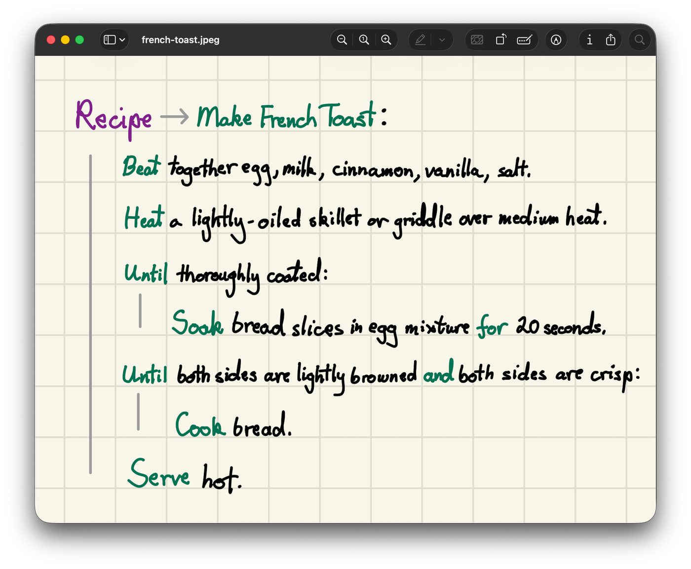
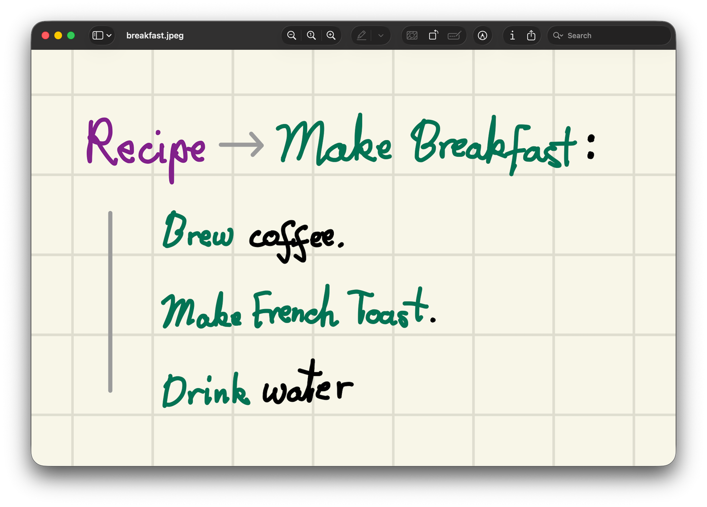
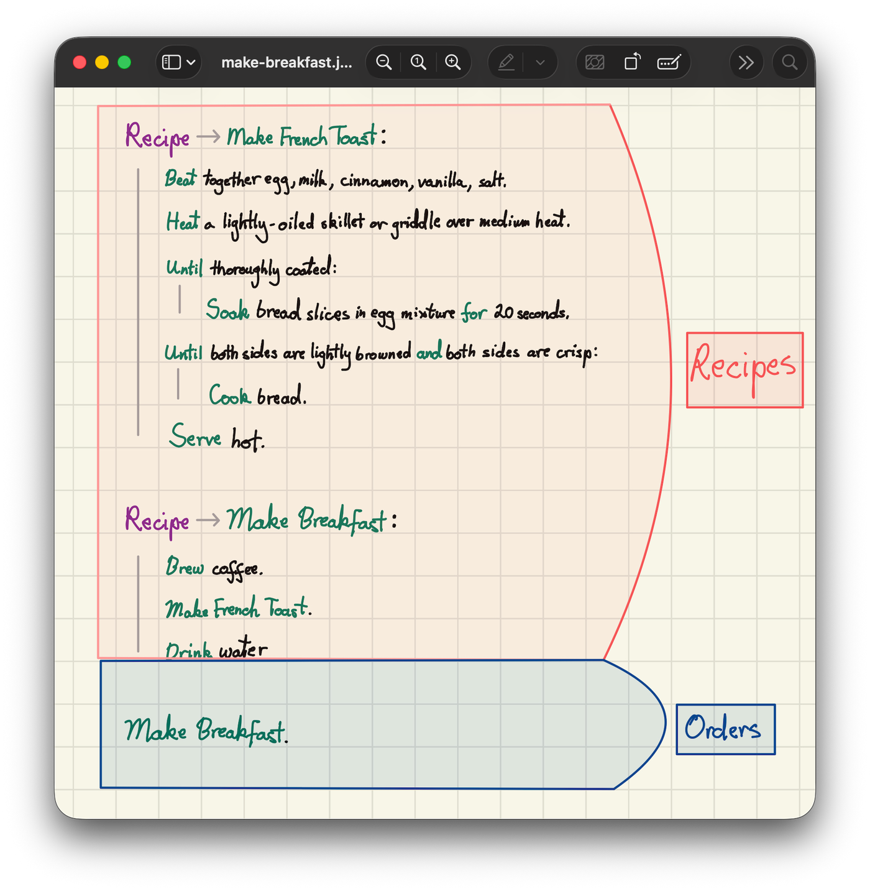
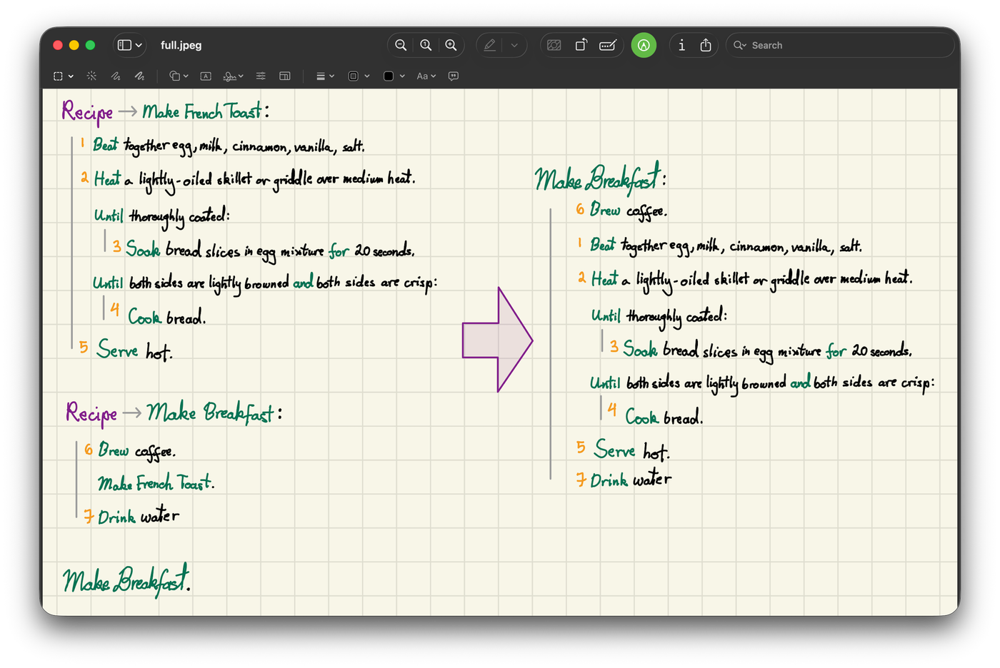
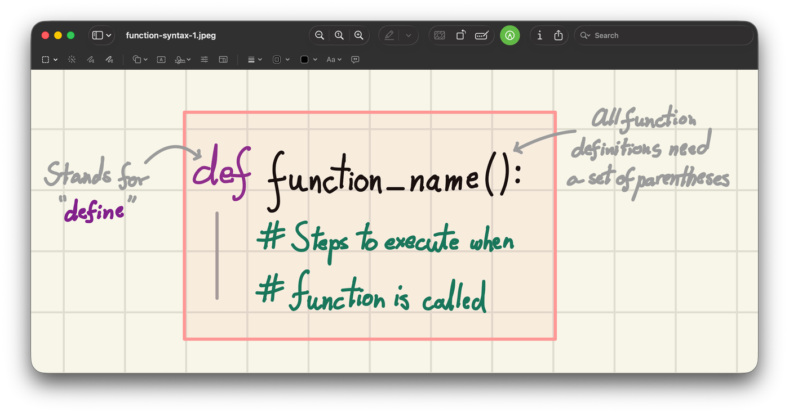
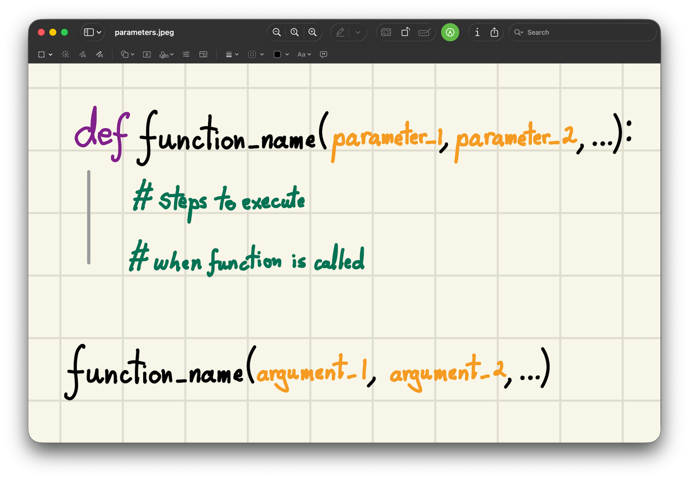

<h2 align=center>Lecture XI</h2>

<h1 align=center>Functions: Parameters</h1>

<h3 align=center>22 de Vendémiaire, de l'Année CCXXXV de la République</h3>

<p align=center><strong><em>Song of the day</strong>: <a href="https://youtu.be/trbwqF0d7NA"><strong><u>Change of Heart</u></strong></a> by The 1975 (2016)</em></p>

0. [**Intro To Functions**](#part-0-intro-to-functions)
1. [**Function Parameters**](#part-1-function-parameters)
2. [**Practice Problems**](#part-2-practice-problems)

### Part 0: _Intro To Functions_

#### ***Of Functions And Recipes***

Programmers are oddly similar to chefs. While the dishes they make all look different from each other, the general
components of each are relatively similar. There are pre-established ways of making a cake's icing, or its core batter,
even if the final touches are different.

Say we had a recipe for making French toast:

<p align=center>
    
</p>

<p align=center>
    <sub>
        <strong>Figure 1</strong>: A recipe for French toast. Notice the loops in it!
    </sub>
</p>

Once we have this recipe written down, we can use it when making more complicated meals, such as breakfast. In the
"recipe" for breakfast, we don't have to include all of the steps necessary for making French toast. We simply have to
say "make French toast," knowing that we have a separate recipe for it:

<p align=center>
    
</p>

<p align=center>
    <sub>
        <strong>Figure 2</strong>: A recipe for breakfast that refers to another recipe.
    </sub>
</p>

We do this primarily to save space when writing complicated recipes, but also because making French toast is a recipe
that could be used in a number of contexts, not just when making breakfast.

Say, then, that you asked me to make breakfast. You are not going to list _all_ of the steps required to make this
breakfast. You are simply going to say:

> _"Make breakfast, please."_

I'd be looking at something like this from my point of view:

<p align=center>
    
</p>

<p align=center>
    <sub>
        <strong>Figure 3</strong>: Our "orders" go in the blue box; our recipes live in the red one.
    </sub>
</p>

All I have to do at this point is follow the recipes I have, in order. Making breakfast:

1. Starts with _brewing_ coffee.
2. Continues with _making_ French toast:
    1. Which starts with _beating_ together egg, etc.
    2. Continues with _heating_ the skillet.
    3. ...
    4. ...
    5. _Serving_ hot.
3. Finally, ends with _drinking_ water.

In other words, our steps look as follows now:

<p align=center>
    
</p>

<p align=center>
    <sub>
        <strong>Figure 4</strong>: Following the "make breakfast" recipe means jumping into the "make French toast" recipe
        and then coming back out of it.
    </sub>
</p>

Where am I headed with this? Well, programmers also have ways of grouping instructions that commonly go together to
achieve a certain result.

Instead of recipes, we call them ***functions***.

#### ***Python Functions***

We've already used Python's built-in functions quite a bit:

- `print()`
- `input()`
- `ord()`
- `chr()`
- etc.

We can also create **our own functions** if we find ourselves using the same code over and over again. For example:

- Unit conversions
- Common statistical calculations
- Processing user input
- Drawing graphics

#### ***Syntax***

To create a function, we use the following syntax:

<p align=center>
    
</p>

<p align=center>
    <sub>
        <strong>Figure 5</strong>: Notice the indentation of the instructions—similar to an <code>if</code>-statement or a loop.
    </sub>
</p>

For example, let's write a simple function that prints all of the numbers from 1 to 10:

```python
def count_one_to_ten():
    for number in range(1, 11):
        print(number, end=' ')
```

If we run the code above, **nothing happens**. Why? Even though we _defined_ the function, we never _used_ it. Using a
function is called ***calling*** it:

> **Function call**: Using a function, by writing its name followed by a set of parentheses.

Defining a function is like writing down a recipe: it doesn't cook anything on its own. Every time we call it, Python
runs the code inside of the definition ([**`count_one_to_ten.py`**](count_one_to_ten.py)):

```python
# function DEFINITION (doesn't run any code by itself)
def count_one_to_ten():
    for number in range(1, 11):
        print(number, end=' ')


# function CALLS (each one runs the code inside the definition)
count_one_to_ten()  # function CALL #1
count_one_to_ten()  # function CALL #2
count_one_to_ten()  # function CALL #3
count_one_to_ten()  # function CALL #4
```

Output:

```text
1 2 3 4 5 6 7 8 9 10 1 2 3 4 5 6 7 8 9 10 1 2 3 4 5 6 7 8 9 10 1 2 3 4 5 6 7 8 9 10 
```

And, since a function call is just another line of code, we can place it anywhere we could place any other
instruction—inside of a loop, for example:

```python
for time in range(5):
    count_one_to_ten()  # function CALL
    print()
```

Output:

```text
1 2 3 4 5 6 7 8 9 10 
1 2 3 4 5 6 7 8 9 10 
1 2 3 4 5 6 7 8 9 10 
1 2 3 4 5 6 7 8 9 10 
1 2 3 4 5 6 7 8 9 10 
```

#### ***Parameters***

Lots of the built-in functions we've used in the past take **arguments** (that is, values inside of their parentheses
when calling them):

```python
from math import pow

result = pow(4, 5)  # the pow function takes 2 arguments

print(result)  # the print function here takes 1 argument only
```

We can have our own functions accept values from the caller, too. Inside of the function definition, we call them
**parameters**:

> **Argument**: What goes inside of the parentheses in a function _call_.
>
> **Parameter**: What goes inside of the parentheses in a function _definition_.

<p align=center>
    
</p>

<p align=center>
    <sub>
        <strong>Figure 6</strong>: The value stored in each argument is passed over to the parameter in the same position.
    </sub>
</p>

Here, our function `function_name` is called at the bottom. Inside its parentheses, we placed **arguments**
(`argument_1`, `argument_2`, etc.). Inside of the function definition, the value stored in `argument_1` is passed over
to `parameter_1`, the value stored in `argument_2` is passed over to `parameter_2`, and so on.

This lets us fix a limitation of `count_one_to_ten()`: it can only ever count to ten. With a parameter, we can count to
whatever number the caller wants:

```python
def count_to(limit):
    for number in range(1, limit + 1):
        print(number, end=' ')


user_input = int(input("Til which number would you like to count? "))
count_to(user_input)
```

Output:

```text
Til which number would you like to count? 5
1 2 3 4 5 
```

Here is what is happening:

- The variable `user_input` holds a value of `5`.
- When we call the function `count_to` in the last line, we use _the value stored inside_ of `user_input` as its
_argument_ (which is `5`).
- This `5` is then passed into the parameter of the `count_to` function, which is called `limit`.
- This means that, when running the body of the `count_to` function, we assume that the value of `limit` is `5`.

Since the argument can be any expression, we can also call our function from inside a loop:

```python
for number in range(1, 11):
    count_to(number)
    print()
```

Output:

```text
1 
1 2 
1 2 3 
1 2 3 4 
1 2 3 4 5 
1 2 3 4 5 6 
1 2 3 4 5 6 7 
1 2 3 4 5 6 7 8 
1 2 3 4 5 6 7 8 9 
1 2 3 4 5 6 7 8 9 10 
```

And a function can take as many parameters as it needs, and do whatever it likes with them—including making decisions:

```python
from random import randrange

MIN = -100
MAX = 100


def print_area(width, height):
    if width < 0 or height < 0:
        print(f"Invalid area: width: {width}, height: {height}")
    else:
        area = width * height
        print(f"{width} x {height} = {area}")


for rectangle in range(10):
    random_width = randrange(MIN, MAX + 1)
    random_height = randrange(MIN, MAX + 1)

    print_area(random_width, random_height)
```

Possible output:

```text
100 x 11 = 1100
Invalid area: width: -39, height: -15
Invalid area: width: -81, height: -47
Invalid area: width: -89, height: -51
97 x 59 = 5723
Invalid area: width: -5, height: 13
Invalid area: width: -55, height: -14
51 x 74 = 3774
98 x 3 = 294
Invalid area: width: -8, height: -45
```

Let's take a closer look at how parameters work.

---

### Part 1: _Function Parameters_

Let's talk about the anatomy of a familiar function call:

```python
name = input("What is your name?")
```

Even though this is just a single line of code, there are actually three things going on here:

1. A **function** call to the `input()` function.
2. The **assignment** of whatever value `input()` returns to the variable `name`.
3. The **passing** of the string `"What is your name?"` as part of the `input()` function call.

That's actually a lot, if we consider the functions we've written so far. Take a function like `add()`, which asks the
user for two numbers, adds them together, and prints the result:

```python
def add():
    number_one = float(input("Enter a number: "))
    number_two = float(input("Enter another number: "))
    addition = number_one + number_two
    print("{} + {} = {}".format(number_one, number_two, addition))
```

When we make a function call, the only thing that is happening is step 1. There is no assignment to anything, nor is
there any passing of data into the `add()` function as part of its invocation.

```python
add()
```

We'll leave assignment for next lecture. What I would like to do instead is to be able to do things like what certain 
methods in the `math` module do. Consider the `pow()` method:

```python
import math

base = float(input("Enter a number to use as the base: "))
power = float(input("Enter a number to use as the power: "))

result = math.pow(base, power)

print(result)
```
The `math.pow()` method accepts two **arguments** in its parentheses during invocation: the base, and the power of the
exponentiation.

> **Arguments**: The values placed between the parentheses of a function _during a function call_.

If we were to write a `pow()` function similar to this one with our current knowledge, we would have to use `input()`
_inside_ its definition. Above, these values exist _outside_ the `math.pow()` definition, and are completely independent
from it.

So, how do we make it so that our `add()` function accepts arguments from the outside, to be used inside the function
definition? Very simply:

```python
def add(number_one, number_two):
    addition = number_one + number_two
    print(addition)
```

Two things changed:

- Inside the set of parentheses of the function signature, we wrote the names of the variables (`number_one` and 
`number_two`) where we will store the values that we anticipate to receive from the outside.
- Since we're using these outside values, stored inside `number_one` and `number_two`, we no longer need to use 
`input()` to ask the user to enter them. Thus, we delete those two lines.

Now, if we wanted to use our `add()` function, we would do so the same way we use `math.pow()`:

```python
user_input_one = float(input("Enter a number to add: "))
user_input_two = float(input("Enter another number to add: "))

add(user_input_one, user_input_two)
```

What was the point of this? It will become clearer as the semester goes along, but in general, you want each of your 
functions to do a **single** thing. `print()`, for instance, only displays the arguments that you pass through its 
parentheses. It doesn't do **anything** else, like calculate the length of your argument, or its ASCII value sum, etc.
It is a function defined to do one thing and one thing only: to print.

Similarly, `add()` should do one thing and one thing only: add. 

<sub>**Note**: Right now, `add()` is technically doing two things: adding and printing. We will take care of that on 
Wednesday.</sub>

---

Something you may have noticed is that the operands passed into `add()` as arguments have different variable names than
they do inside the definition of `add()`:

```python
# Function definition
def add(number_one, number_two):
    addition = number_one + number_two
    print(addition)

    
# Function invocation/call    
user_input_one = float(input("Enter a number to add: "))
user_input_two = float(input("Enter another number to add: "))

add(user_input_one, user_input_two)
```

This, however, still works perfectly fine if we run it:

```text
Enter a number to add: 42
Enter another number to add: 24
66.0
```

This is _by far_ the part of functions that confuses students the most. If the first number is called `number_one` 
inside the function, why can I pass a variable called `user_input_one` into it?

This is because `number_one` and `number_two` are what are called **parameters**, as opposed to arguments (which we 
defined earlier).

> **Parameters**: The values placed between the parentheses of, and then used in, a function _definition_.

So, in the line:

```python
add(user_input_one, user_input_two)
```

This is what is happening:

1. The values stored inside the variables `user_input_one` (say, `42`) and `user_input_two` (say, `24`) are passed in as
***arguments*** to the `add()` function during invocation.
2. Since `user_input_one` is passed first, the value stored inside it is then assigned to the first ***parameter*** in 
the `add()` function definition. In this case, the first parameter is `number_one`. Thus, `number_one` also has the
value of `42`.
3. Since `user_input_two` is passed second, the value stored inside it is then assigned to the second ***parameter*** in 
the `add()` function definition. In this case, the second parameter is `number_two`. Thus, `number_two` now also has the
value of `24`.
4. `add()` has thus "received" values from outside its own definition, and can use them in its operations.

What makes this more confusing is that you *can* name your arguments and parameters the same:

```python
# Function definition
def add(number_one, number_two):
    addition = number_one + number_two
    print(addition)

    
# Function invocation/call    
number_one = float(input("Enter a number to add: "))
number_two = float(input("Enter another number to add: "))

add(number_one, number_two)
```

This is possible and works totally fine, so why not do this? Imagine you work for 
[**NASA**](https://en.wikipedia.org/wiki/NASA) as an astrophysicist, and you need a formula to calculate the volume of 
a planet. You might write a function like this:

```python
import math

SPHERE_VOL_CONSTANT = math.pi * 4 / 3


def print_volume_of_planet(planet_radius):
    planet_volume = SPHERE_VOL_CONSTANT * planet_radius ** 3
    print("The volume of this planet is {}".format(planet_volume))


planet_radius = 6378.0  # Earth; in km; approx.
print_volume_of_planet(planet_radius)
```
Output:
```text
The volume of this planet is 1086781292542.8892
```

Cool, but in space, there are all sorts of object that are spherical. Let's say we wanted a function that will calculate
the volume of a star. You might do this:

```python
import math

SPHERE_VOL_CONSTANT = math.pi * 4 / 3


def print_volume_of_star(star_radius):
    star_volume = SPHERE_VOL_CONSTANT * star_radius ** 3
    print("The volume of this star is {}".format(star_volume))


star_radius = 37.5  # Polaris; in Solar radii; approx.
print_volume_of_star(star_radius)
```

The inefficiency here is probably pretty clear: both functions do _exactly the same thing, in the exact same way_. The
question here is: why have two functions that do the same thing for specific situations, when we can have one single 
function that will work for both? 

The [**ideal way**](print_volume_of_sphere.py) to write a function like this would be:

```python
import math

SPHERE_VOL_CONSTANT = math.pi * 4 / 3


def print_volume_of_sphere(radius):
    volume = SPHERE_VOL_CONSTANT * radius ** 3
    print("The volume of this spherical object is {}.".format(volume))


earth_radius = 6378  # in km; approx.
print_volume_of_sphere(earth_radius)

polaris_radius = 37.5  # in Solar radii; approx.
print_volume_of_sphere(polaris_radius)
```

This makes `print_volume_of_sphere()` an extremely reusable function that can be used with literally any sphere, astral 
body or not.

---

### Part 2: _Practice Problems_

**Problem 1: Temperature Converter**

Write a function called `print_temps` that:

- Accepts 1 parameter, `temp_fahr`, which represents a temperature in Fahrenheit units.
- Calculates the equivalent temperatures in:
    - Celsius (°C = (°F − 32) × 5/9)
    - Kelvin (K = °C + 273.15)
    - Rankine (°R = °F + 459.67)
- Prints a report including all four units, rounded to two decimal places.

Once you write your function, generate a random Fahrenheit value between `0.0` and `100.0` and use it as an argument to
call your `print_temps` function.

**Optional**: Using `f`-strings or `.format()`, format the output to look exactly like it does in the example below
(each value is right-aligned in a width of 10, and is separated from its label by a tab).

Sample execution when the random Fahrenheit value is `77.98`:

```text
TEMPERATURE EQUIVALENTS
- FAHRENHEIT:	     77.98
- CELSIUS:	     25.54
- KELVIN:	    298.69
- RANKINE:	    537.65
```

You can find the full solution [**here**](solutions/print_temps.py) (in the [**`solutions`**](solutions) sub-folder).

---

<sub>**Previous: [Strings Methods, Slicing, & Formatting](/lectures/10-manipulating-strings)** | **Next: [Functions: `return`](/lectures/12-functions-return/)**</sub>
