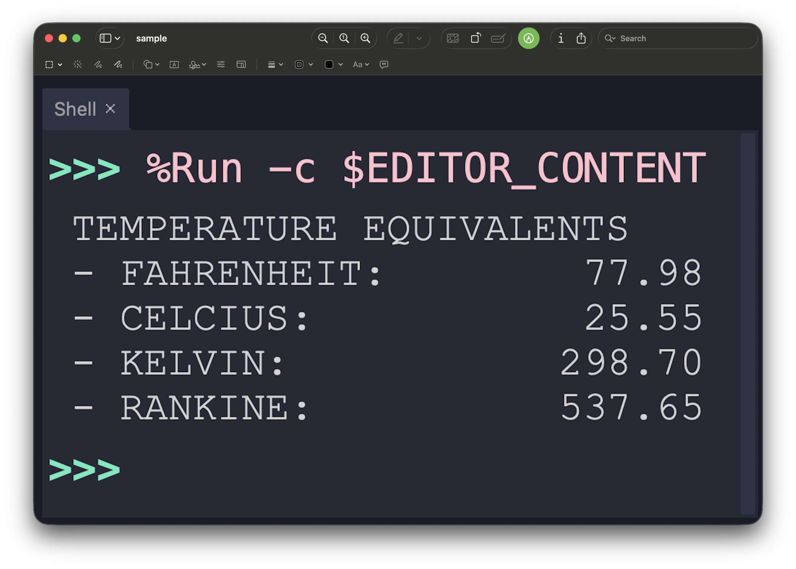

<h2 align=center>Lecture XII</h2>

<h1 align=center>The <code>return</code> Statement</h1>

<h3 align=center>27 de Vendémiaire, de l'Année CCXXXV de la République</h3>

***Song of the day:*** _[**愛の讃歌 (Hymn to Love)**](https://youtu.be/pJXAJMcom0s) by UlulU (2022)._

0. [**Functions Practice**](#part-0-simply-having-a-functional-christmas-time)
1. [**Revisiting `print()` and Default Parameters**](#part-1-revisiting-print-and-default-parameters)
2. [**The `return` Statement**](#part-2-the-return-statement)

### Part 0: _Functions Practice_

Write a function called `print_temps` that:
- Accepts 1 parameter, `temp_fahr`, which represents a temperature in Fahrenheit units.
- Calculates the equivalent temperatures in:
    - Celcius (°C = °F * 9/5 + 32)
    - Kelvin (°K = °C + 273.15)
    - Rankine (°R = °F + 459.67)
- Prints a report including all units, rounded to two decimal units.

Once you write your function, generate a random Fahrenheit value between 0.0°F and 100.0°F and use it as an argument to call your `print_temps` function.

**Optional**: Using `f`-strings/`.format`, format the output to look exactly like it does in my example. (I'm using a tab and a width of 10)

<p align=center>
    
</p>

### Part 1: _Revisiting `print()` and Default Parameters_

Speaking of parameters, you have actually been using some of them since the beginning of the semester. We've already
used `print()`'s `sep` and `end` options, without really talking about what they are. Now that we know how parameters
work, we can finally explain them.

If we simply pass objects as arguments into the `print()` function, we know that it will print the values of those
objects, separated by a single space (`" "`):

```python
first_call = 3
second_call = 2
final_call = 1
start = 0
print(first_call, second_call, final_call, start)
```

Output:

```text
3 2 1 0
```

So why does Python separate these arguments by a space? Remember `sep`? It turns out that it is a **parameter** of the
`print()` function (short for separator) *whose default value is a single space*. Because this is the default value,
`print()` will take every argument we passed to it, and print them in order, separated by a space.

When we wrote `sep="..."` before, we were overriding that default:

```python
first_call = 3
second_call = 2
final_call = 1
start = 0
print(first_call, second_call, final_call, start, sep="...")
```

Output:

```text
3...2...1...0
```

Here, we've told the `print()` function to replace its default separator for the string `"..."`. Notice that we have to
explicitly type `sep=` in order to change the separator. Don't forget to do so—`print()` will just assume that it is 
another parameter to `print()`.

To generalize this behavior, here's what the `print()` function's definition's signature probably looks like:

```python
def print(object1, object2, …, sep=' '):
    # more code
    # more code
```

Giving a parameter a value in the function signature gives it a **default** value. These are useful when you have 
functions that give the user the option of entering their own value if they choose to do so. If they don't, the function
will use the default parameter:

```python
def make_french_fries(number_of_orders, uses_air_fryer=False):
    if uses_air_fryer:
        print("Making", number_of_orders, "french fries orders using an air fryer.")
    else:
        print("Making", number_of_orders, "french fries orders using an oil fryer.")

def main():
    make_french_fries(10)
    make_french_fries(7, True)
    make_french_fries(3, uses_air_fryer=True)
    make_french_fries(number_of_orders=20, uses_air_fryer=False)

main()
```

<sub>**Code block 1**: These are all valid function calls for `make_french_fries()`.</sub>

Output:

```text
Making 10 french fries orders using an oil fryer.
Making 7 french fries orders using an air fryer.
Making 3 french fries orders using an air fryer.
Making 20 french fries orders using an oil fryer.
```

The same is true of `end`, the other `print()` parameter we've been using. Its default value is `"\n"`, which is why
every `print()` call starts a new line unless we pass something else, like `end=' '`.

### Part 2: _The `return` Statement_

Remember how the `range()` function accepted arguments for its start, stop, and step values, and then gave us back a
sequence based on those numbers?

```python
def main():
    zero_to_ten_evens = range(0, 11, 2)

    print("The numbers inside this sequence are...")
    for number in zero_to_ten_evens:
        print(number)

main()
```

Output:

```text
The numbers inside this sequence are...
0
2
4
6
8
10
```

That is, we set the variable `zero_to_ten_evens` to `range(0, 11, 2)`, but the actual value that this is equivalent to
is a sequence from 0 to 11 with a step of two.

This is one way this can be said in English:

> The function `range()`, when given the arguments `0`, `11`, and `2`, ***returns*** a sequence from 0 to 11 with a step
> of two to the variable `zero_to_ten_evens`.

This is certainly not the only built-in Python function that we have seen that shows this behavior. Consider the
`input()` function; in English, you would say:

> The function `input()`, when given a prompt as an argument, ***returns*** the string that the user typed in.
> 
> The function `int()`, when given a string containing an integer as an argument, ***returns*** the `int` equivalent
> of that string input.

You can probably see where this is going: functions can return values. So far, all of our functions have either worked in
isolation of the outside world (i.e. do not accept parameters), or accept data from the outside world through 
parameters and then use that data inside the function (like the cylinder function below).

We've thus far only printed the results of our functions, but more often than not, you'll want your functions to 
actually ***return*** the result to the outside world so that you can use that result in other unrelated calculations.
(the `input()` function would be pretty useless if all it did was print our input again, and not actually let us save 
it in a variable).

Here's a function that calculates the volume of a cylinder, but only _prints_ the result:

```python
PI = 3.1415


def print_cylinder_volume(radius, height):
    volume = PI * (radius ** 2) * height
    print(volume)
```

<sub>**Code block 2**: `print_cylinder_volume()` shows us the volume, but it doesn't let us do anything else with it.</sub>

Let's modify the code from code block 2 to return the result of our volume calculations:

```python
PI = 3.1415


def get_cylinder_volume(radius, height):
    """
    Calculates the volume of a cylinder of a given radius and height.
    
    :param radius: A float or integer representing the radius of the bases
    :param height: A float or integer representing the height of the cylinder
    :return: volume: A float representing the volume of our cylinder.
    """
    volume = PI * (radius ** 2) * height

    return volume


def main():
    sample_radius = 5
    sample_height = 1.4
    get_cylinder_volume(sample_radius, sample_height)


main()
```

<sub>**Code block 3**: `print_cylinder_volume()` is now `get_cylinder_volume()`.</sub>

That's it. Notice though, that our docstring also changed, because now we're actually returning something, so by 
convention we usually write the name of the returned variable, and a short explanation.

Now, if we ran this, nothing would show up in our Terminal screen. Why? Because we're no longer printing anything.
`get_cylinder_volume()` calculates the volume of our cylinder and returns it. The problem is that we're not saving that 
returned value anywhere. Exactly the same way that we need to save the returned value from the `input()` function, we 
need to save the returned value from `get_cylinder_volume()` in a variable in order to use it:

```python
PI = 3.1415


def get_cylinder_volume(radius, height):
    """
    Calculates the volume of a cylinder of a given radius and height.
    
    :param radius: A float or integer representing the radius of the bases
    :param height: A float or integer representing the height of the cylinder
    :return: volume: A float representing the volume of our cylinder.
    """
    volume = PI * (radius ** 2) * height

    return volume


def main():
    sample_radius = 5
    sample_height = 1.4
    cylinder_volume = get_cylinder_volume(sample_radius, sample_height)  # our result is being stored here
    
    print("The volume of the cylinder is", cylinder_volume)  # our result is being used here

main()
```

<sub>**Previous: [Functions: Parameters](/lectures/11-functions-parameters/)** | **Next: [File Input](/lectures/13-file-input/)**</sub>
