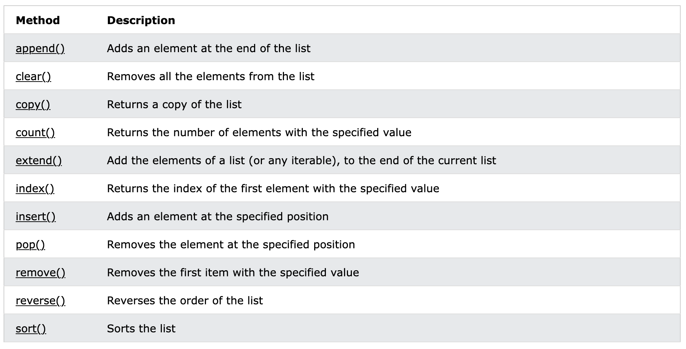

<h2 align=center>Lecture XV</h2>

<h1 align=center>Python Lists</h1>

<h3 align=center>11 de Brumaire, de l'Année CCXXXV de la République</h3>

***Song of the day:*** _[**Karaté Cœur**](https://youtu.be/Unf9Jzp-yRQ) Zaoui (2026)._

0. [**An Introduction To Python Lists**](#part-0-an-introduction-to-python-lists)
1. [**Lists As Sequences**](#part-1-lists-as-sequences)
2. [**List Methods**](#part-2-list-methods)
3. [**Reading CSV Files And `split()`**](#part-3-reading-csv-files-and-split)

### Part 0: _An Introduction to Python Lists_

So, we've seen sequences of numbers, and we've seen sequences of characters. There's not really anything else in the
world of computing that gets more atomic than that—ones and zeroes are numbers, after all.

So instead of looking to smaller things, let's think the exact opposite way: numbers, characters, and really everything
in Python are objects. So can we store a sequence of objects? SURE CAN.

```python
CURRENT_YEAR = 2026

name = "Léa Seydoux"
age = 41
hometown = "Paris"
occupation = "Actress"
years_active = range(2005, CURRENT_YEAR + 1)

information = [name, age, hometown, occupation, years_active]
print(information)
```

Output:

```text
['Léa Seydoux', 41, 'Paris', 'Actress', range(2005, 2027)]
```

Say hello to the Python list. In technical terms:

> **List**: A data type representing a sequence of objects. These objects (the elements of a list) can be of different 
> types.

Here's another example of a list:

```python
character = ["Link", 10, True, ["Kokiri Sword", "Razor Sword", "Gilded Sword"]]
```

<sub>**Code block 1**: Even lists can be elements of a list.</sub>

### Part 1: _Lists as Sequences_

It also turns out that **indexing** works with the exact same syntax that we use for strings:

```python
CURRENT_YEAR = 2026

name = "Léa Seydoux"
age = 41
hometown = "Paris"
occupation = "Actress"
years_active = range(2005, CURRENT_YEAR + 1)

information = [name, age, hometown, occupation, years_active]

print(f"{information[0]}, a(n) {information[3].lower()} from {information[2]}")
```

Output:

```text
Léa Seydoux, a(n) actress from Paris
```

By way of a more useful example say that we have a list populated by integers and floats. How would we find the average of
these numbers?

```python
sample_list = [10, 50.6, -44, -0.0001, 56.00043, 45]

average = get_list_average(sample_list)

print(average)
```

Well, let's write the function stub first, before anything else:

```python
def get_list_average(numbers):
    pass
```

A list is a **sequence of elements**, the same way that a string is a sequence of characters
and a range is a sequence of numbers. Therefore, we can iterate through it using a `for`-loop. How does this help us?
Well, in order to calculate the average of any set of numbers, we need both the sum of those numbers, and the amount
of numbers in that set. We can get both of these things via a `for`-loop:

```python
def get_list_average(numbers):
    total_sum = 0
    length = 0

    for number in numbers:
        total_sum += number
        length += 1

    average = total_sum / length
    return average
```

There's one thing we should be careful here, though. If the list that the user passes in as an argument turns out to be 
empty, our `average` calculation will yield a divide-by-zero error, so we should add a failsafe mechanism for that. 
Turns out that, just like with strings, we can use the `len()` function to get the length of a list. Let's use that to
our advantage:

```python
def get_list_average(numbers):
    length = len(numbers)

    if length == 0:
        print("WARNING: List is empty. Returning 0.0")
        return 0.0
    
    total_sum = 0

    for number in numbers:
        total_sum += number

    average = total_sum / length
    return average
```

<sub>**Code block 2**: In this whole function, we never see list-specific behavior. We're just treating it like a sequence 
of numbers.</sub>

What does that mean for lists? If we can treat lists like sequences and, as we have seen, we can index them to
get individual values, we can iterate through lists using indexing! Let's say we wanted to write a function that returns
the **index of the largest number in a list of positive numbers**. By definition, we need to use indexing, so let's set
up our function to do that:

```python
def get_index_of_largest(numbers):
    length = len(numbers)

    for index in range(length):
        current_element = numbers[index]
        
        # Our algorithm
```

To find the largest number, we need to keep track of the current largest number, and if we encounter a number that is 
larger than the current largest number, we make the new number the current largest number. Since we made the assumption
that the list will contain positive numbers only, our starting value can simply be `-1` or any other negative number,
since we can safely assume that no positive number will be lower than it:

```python
def get_index_of_largest(numbers):
    length = len(numbers)
    largest_number = -1
    largest_index = -1

    for index in range(length):
        current_element = numbers[index]
        if current_element > largest_number:
            largest_number = current_element
            largest_index = index

    return largest_index


def main():
    sample_list = [20, 45, 34.56432, 1, 2.3, 1.00002, 45.0000002, 5]
    largest_index = get_index_of_largest(sample_list)
    print(f"The index of the largest number in the list {sample_list} is {largest_index}.")


main()
```

Output:

```text
The index of the largest number in the list [20, 45, 34.56432, 1, 2.3, 1.00002, 45.0000002, 5] is 6.
```

On the topic of indexing, it's also worth remembering that you can also **slice** lists the same way you would a string:

```python
numbers = [1, 2, 3, 4, 5]

for index in range(len(numbers)):
    current_slice = numbers[:index + 1]
    print(f"Current slice: {current_slice}")
```

Output:

```text
Current slice: [1]
Current slice: [1, 2]
Current slice: [1, 2, 3]
Current slice: [1, 2, 3, 4]
Current slice: [1, 2, 3, 4, 5]
```

So, we can iterate and index through a list. In a similar fashion to `range()` and strings, we can also check for 
membership of elements using the `in` operator:

```python
french_revolution_years = [1789, 1830, 1848]
year = 1967

print(year in french_revolution_years)
```

Output:

```text
False
```

In other words, the value `1967`, stored in the variable `year`, does _not_ exist in the sequence (i.e. list)
stored in the variable `french_revolution_years`.

Here's couple more examples:

```python
>>> print(5 in [3, 6, [5, 7]])
False

>>> print(7 not in [1, 2, 3, 4])
True
```

---

### Part 2: _List Methods_

Here's a list of list methods that you'll want to be aware of in this class:



<sub>**Figure 1**: List methods ([**source**](https://www.w3schools.com/python/python_ref_list.asp)). </sub>

---

### Part 3: _Reading CSV Files and `split()`_

Back in our file lectures, we read CSV (comma-separated values) files one line at a time. Each line looked something
like this:

```text
San Francisco,47
```

and, to get the city and the temperature out of it, we used `find()` to locate the comma, and then sliced the string
around it. That worked, but it was a lot of work for a line with only two values. Real CSV files often have many more
columns than that. For example, take a look at [**`library.csv`**](library.csv):

```text
Title,Last Played,Play Time (hrs),Achievements
Omori,10/29/21,16.5,16/84
Portal 2,04/28/16,5.7,16/51
Civilization V,09/04/18,22.9,20/286
Hyper Light Drifter,04/04/18,15.5,4/23
TIS-100,04/29/19,10.6,1/10
```

Finding three commas and slicing four times for every line would be miserable. What we really want is a way of
**breaking a line up into its individual values**. Now that we know about lists, we have the perfect place to put them.

Strings have a method called `split()` that does exactly this. It **returns a list of strings**, made by cutting the
original string wherever it finds the **separator** that you pass in as an argument ([**`split_examples.py`**](split_examples.py)):

```python
line = "San Francisco,47"
pieces = line.split(',')

print(pieces)
print(pieces[0])
print(pieces[1])
```

Output:

```text
['San Francisco', '47']
San Francisco
47
```

> **`split(separator)`**: Returns a list of the pieces of a string that are separated by `separator`. The separator
> itself is not included in any of the pieces.

Since the result is a list, everything that we have learned so far applies: we can index it, slice it, iterate through
it, and check its length with `len()`. There are a couple of things to keep in mind, though:

- **Every piece is a string**, even if it looks like a number. `'47'` is not `47`, so we have to cast it with `int()` or
`float()` before doing arithmetic with it.
- **Whitespace and newlines stay in the pieces.** Lines that we read from a file end with a `'\n'`, which would end up
glued to the last piece, so it is a good habit to `strip()` the line _before_ splitting it.
- **Consecutive separators produce empty strings.** That is not a bug; it is `split()` telling you that there was
nothing between the two separators.

```python
print("Boston,51\n".split(','))
print("a,,b".split(','))
```

Output:

```text
['Boston', '51\n']
['a', '', 'b']
```

There is also a special case that is worth knowing about. If you call `split()` with **no** arguments, it splits on
whitespace (spaces, tabs, and newlines), and treats any number of consecutive whitespace characters as a single
separator:

```python
print("  to be   or not  ".split())
print("  to be   or not  ".split(' '))
```

Output:

```text
['to', 'be', 'or', 'not']
['', '', 'to', 'be', '', '', 'or', 'not', '', '']
```

Let's put this to work. Here is our temperature program from the file input lecture, rewritten with `split()`
([**`display_temperatures_split.py`**](display_temperatures_split.py)):

```python
def get_celsius(fahrenheit_temp):
    return (fahrenheit_temp - 32.0) * (5.0 / 9.0)


def display_temperatures(filepath):
    with open(filepath, 'r') as temp_file:
        temp_file.readline()  # header

        for line in temp_file:
            pieces = line.strip().split(',')

            city_name = pieces[0]
            temperature = float(pieces[1])

            print(f"The temperature in {city_name} is {round(get_celsius(temperature), 2)}°C.")


display_temperatures("data.csv")
```

Output:

```text
The temperature in San Francisco is 8.33°C.
The temperature in Manhattan is 13.89°C.
The temperature in Boston is 10.56°C.
The temperature in Houston is 20.0°C.
The temperature in St. James is 10.0°C.
```

The four lines that located the comma and sliced the string have become two lines that index a list. And the same idea
scales to as many columns as we like. If we wanted the average play time from `library.csv`, we would only need column
`2`, and we could use the `get_list_average()` function that we wrote earlier on a list that we build as we read the
file. We build it by starting from an empty list, `[]`, and using the `append()` list method (see **figure 1**) to add each
new value to the end of it ([**`average_play_time.py`**](average_play_time.py)):

```python
TITLE_IDX = 0
PLAY_TIME_IDX = 2


def get_list_average(numbers):
    if len(numbers) == 0:
        return 0.0

    total_sum = 0
    for number in numbers:
        total_sum += number

    return total_sum / len(numbers)


with open("library.csv", 'r') as library_file:
    library_file.readline()  # header

    play_times = []
    for line in library_file:
        pieces = line.strip().split(',')
        print(f"{pieces[TITLE_IDX]}: {pieces[PLAY_TIME_IDX]} hours")
        play_times.append(float(pieces[PLAY_TIME_IDX]))

print(f"Average play time: {round(get_list_average(play_times), 2)} hours")
```

Output:

```text
Omori: 16.5 hours
Portal 2: 5.7 hours
Civilization V: 22.9 hours
Hyper Light Drifter: 15.5 hours
TIS-100: 10.6 hours
Average play time: 14.24 hours
```

Last, remember the file method `readlines()`, the one that we said to stay away from until we learned about lists? Now
we can finally explain it: it returns a **list of strings**, one for each line of the file:

```python
with open("library.csv", 'r') as library_file:
    lines = library_file.readlines()

print(lines[:2])
```

Output:

```text
['Title,Last Played,Play Time (hrs),Achievements\n', 'Omori,10/29/21,16.5,16/84\n']
```

Iterating through the file directly with a `for`-loop, as we have been doing, is usually the better choice, since it
never needs to hold the entire file in memory. But `readlines()` is handy when you need all of the lines at once.

---

<sub>**Previous: [Exceptions and File Output](/lectures/14-file-output-and-exceptions/)** | **Next: [List Methods, Tuples, and Memory Maps](/lectures/16-list-methods-tuples-memory/)**</sub>
