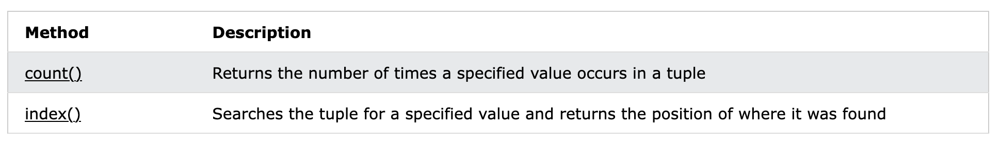
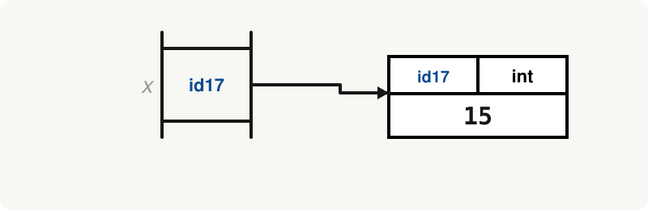
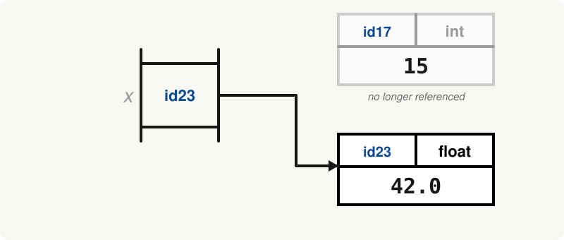
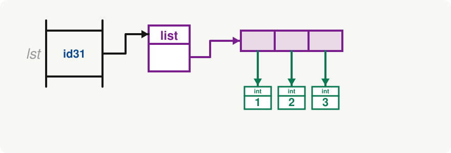
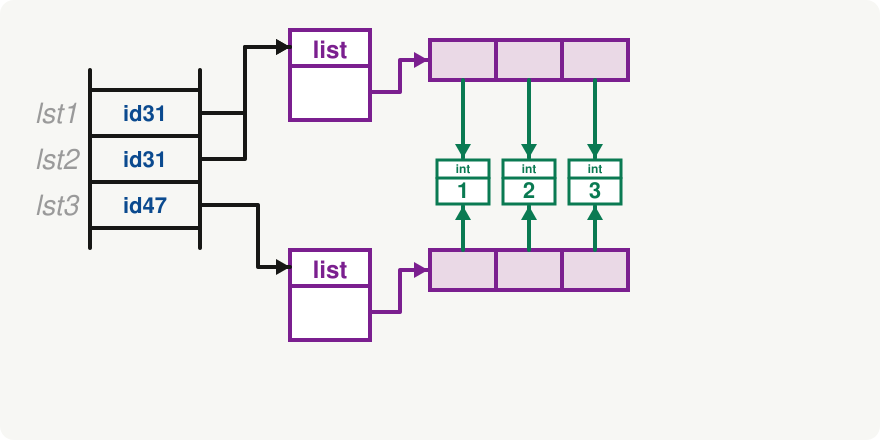
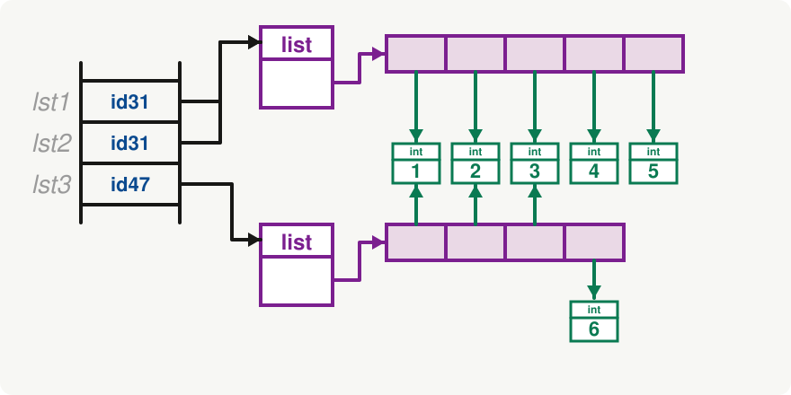
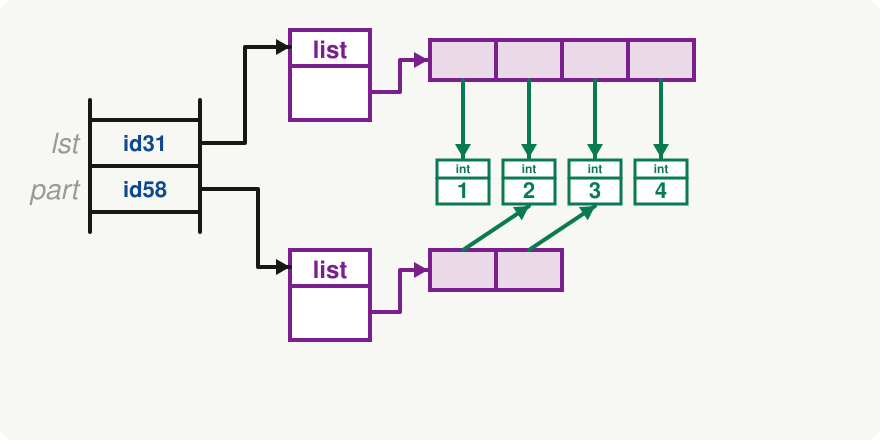
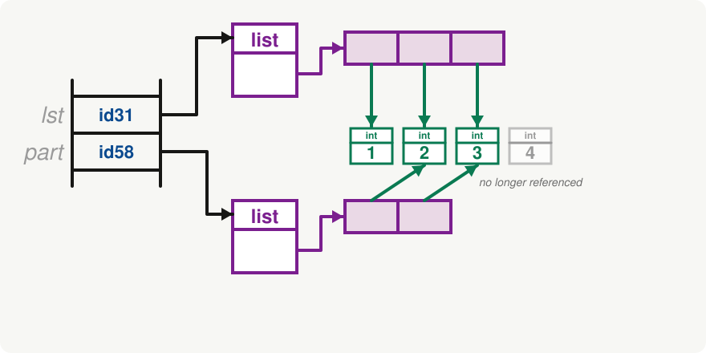

<h2 align=center>Lecture XVI</h2>

<h1 align=center>List Methods, Tuples, and Memory Maps</h1>

<h3 align=center>13 de Brumaire, de l'Année CCXXXV de la République</h3>

***Song of the day:*** _[**Piledriver Waltz**](https://youtu.be/GmOxB-gXhs4) Alex Turner (2015)._

0. [**Tuples**](#part-0-tuples)
1. [**Adding To Lists**](#part-1-adding-to-lists)
2. [**Deleting From Lists**](#part-2-deleting-from-lists)
3. [**Other List Methods**](#part-3-other-list-methods)
4. [**A First Look At Memory Maps**](#part-4-a-first-look-at-memory-maps)

### Part 0: _Tuples_

Last lecture, we learned that a list is a sequence of objects that we can index, slice, and iterate through. Today we
start with a close cousin of the list that, at first glance, will look awfully familiar: the **tuple**. A tuple looks as
follows ([**`tuples.py`**](tuples.py)):

```python
dubrovnik = ("Croatia", "Dubrovnik-Neretva", 21.35, 3, "UTC+1", "Saint Blaise")
print(dubrovnik)
```

Output:

```text
('Croatia', 'Dubrovnik-Neretva', 21.35, 3, 'UTC+1', 'Saint Blaise')
```

So far, it basically just looks like a list. We can even index it and iterate through it as if it were a list:

```python
for element in dubrovnik:
    print(element)

for index in range(len(dubrovnik)):
    print(f"Element #{index}: {dubrovnik[index]}")
```

Output:

```text
Croatia
Dubrovnik-Neretva
21.35
3
UTC+1
Saint Blaise
Element #0: Croatia
Element #1: Dubrovnik-Neretva
Element #2: 21.35
Element #3: 3
Element #4: UTC+1
Element #5: Saint Blaise
```

So why the need for tuples at all? Their main difference (from where all of its other differences derive from) is that
**tuples are immutable**:

```python
azuna = ("Ayumu", "Setsuna", "Shizuku")
azuna[0] = "Shioriko"
```

Output:

```text
Traceback (most recent call last):
  File "<input>", line 1, in <module>
TypeError: 'tuple' object does not support item assignment
```

That error's last line tells us all we need to know. Naturally, then, the list of tuple methods is much shorter than the
list object's:



<sub>**Figure 1**: PyCharm suggesting tuple attributes and methods. We basically only have `index()` and `count()`
available for free use. </sub>

While tuples may seem restrictive and almost useless given the flexibility of lists, their ability to hold data and
guarantee its immutability is an extremely helpful power to have in computer science. Examples include, let's say, a
city's coordinates or the red, green, and blue values of a colour:

```python
kyoto_coordinates = (35.0116, 135.7681)
brand_colour = (193, 39, 45)
```

We know that neither of these values will **ever** change throughout the duration of our program (at least, I sure
_hope_ they don't). So the ability to store them in an immutable collection acts as a safeguard from your program or
teammate accidentally editing them by mistake.

Tuples are also what Python uses when a function **returns more than one value**, and they allow us to define multiple
variables at once:

```python
def get_min_and_max(values):
    return min(values), max(values)


lowest, highest = get_min_and_max([4, 9, 2])
print(lowest, highest)
```

Output:

```text
2 9
```

One small detail: a tuple with a single element needs a trailing comma, otherwise Python reads the parentheses as
regular grouping parentheses:

```python
print(type((5,)), type((5)))
```

Output:

```text
<class 'tuple'> <class 'int'>
```

So a tuple is, in a way, a list that promises never to change. Which raises the question for the rest of today's lecture:
how do lists **change**? That is what most of the methods in last lecture's table are for, so let's go through them.

### Part 1: _Adding To Lists_

Lists, unlike tuples, can change, and Python gives us a whole set of methods to do it. Last lecture, we looked at a
table of them and promised to come back to it. Today we do. Most of the methods in that table fall into three groups:
methods that **add** to a list, methods that **delete** from a list, and everything else. Let's start with the first
group.

The simplest way of adding an element to a list is the `append()` method, which adds a single element to the **end**:

```python
grades = [87.0, 56.0, 100.0]

grades.append(91.5)
print(grades)
```

Output:

```text
[87.0, 56.0, 100.0, 91.5]
```

If we want to add an element somewhere other than the end, we use `insert()`. It takes two arguments: the **index** where
the new element should go, and the **element** itself. Everything from that index onwards gets shifted one position to
the right:

```python
grades.insert(1, 72.5)
print(grades)
```

Output:

```text
[87.0, 72.5, 56.0, 100.0, 91.5]
```

What if we have several elements to add? We could call `append()` over and over inside of a loop, but there is a
method made for it, `extend()`, which adds **every element** of another sequence to the end of the list:

```python
grades.extend([60.0, 45.5])
print(grades)
```

Output:

```text
[87.0, 72.5, 56.0, 100.0, 91.5, 60.0, 45.5]
```

It's very easy to confuse `append()` and `extend()`, so let's put them side by side ([**`adding.py`**](adding.py)):

```python
appended = [1, 2]
appended.append([3, 4])
print(appended)

extended = [1, 2]
extended.extend([3, 4])
print(extended)
```

Output:

```text
[1, 2, [3, 4]]
[1, 2, 3, 4]
```

`append()` adds **one** element, and that one element happens to be a list. `extend()` adds **each** of the elements of
the list that we give it.

There is also a way of adding lists together **without** changing either of them: the `+` operator. It creates a
**brand new list** out of the two lists that we give it:

```python
added = [1, 2]
added = added + [3, 4]
print(added)
```

Output:

```text
[1, 2, 3, 4]
```

#### _A very common mistake_

Methods like `append()`, `insert()`, and `extend()` all **change the list that they were called on**, and they **return
`None`**. They don't return the new list. This leads to one of the most common bugs in programs that use lists:

```python
mistake = [1, 2]
mistake = mistake.append(3)
print(mistake)
```

Output:

```text
None
```

The `append()` call worked perfectly well: `3` was added to the list. But then we reassigned the variable `mistake` to
whatever `append()` returned, which is `None`, and we lost our list. When you call a method that changes a list, just
call it; don't save the result.

### Part 2: _Deleting From Lists_

The opposite of `append()` is `pop()`. It removes an element from the list **and returns it**, so that you can use it.
Without any arguments, it removes the **last** element. If you give it an index, it removes the element at that index
instead ([**`deleting.py`**](deleting.py)):

```python
pets = ["cat", "dog", "bird", "dog"]

print(pets.pop(), pets)
print(pets.pop(0), pets)
```

Output:

```text
dog ['cat', 'dog', 'bird']
cat ['dog', 'bird']
```

If the list is empty, or the index you give `pop()` doesn't exist, you get an `IndexError`:

```python
[].pop()
```

Output:

```text
IndexError: pop from empty list
```

When we know the **value** that we want to remove, but not its index, we use `remove()`. It removes the **first** element
that is equal to the value we give it:

```python
pets = ["cat", "dog", "bird", "dog"]
pets.remove("dog")
print(pets)
```

Output:

```text
['cat', 'bird', 'dog']
```

Notice that only the first `"dog"` was removed. And if the value isn't in the list at all, you get an error:

```python
pets.remove("fish")
```

Output:

```text
ValueError: list.remove(x): x not in list
```

Finally, if we want to remove **everything**, there is `clear()`:

```python
pets.clear()
print(pets)
```

Output:

```text
[]
```

#### _Removing while looping_

Here's something that will trip you up at some point. Say we want to remove every `2` from a list, so we write the
following:

```python
numbers = [1, 2, 2, 3, 2]
for number in numbers:
    if number == 2:
        numbers.remove(number)
print(numbers)
```

Output:

```text
[1, 3, 2]
```

There is still a `2` in there! What happened? Every time we remove an element, everything after it **shifts one position
to the left**. The `for`-loop doesn't know that, so on its next turn it moves on to the next index, and skips over the
element that just took the removed element's place.

The safest way of getting rid of elements while looping is to **not change the list you are looping through**. Instead,
build a new list with the elements that you want to keep:

```python
numbers = [1, 2, 2, 3, 2]
kept = []
for number in numbers:
    if number != 2:
        kept.append(number)
print(kept)
```

Output:

```text
[1, 3]
```

### Part 3: _Other List Methods_

The remaining methods from last lecture's table don't add or delete anything. Two of them look for things
([**`other_methods.py`**](other_methods.py)):

- `index(value)`: Returns the index of the **first** element equal to `value`. If it isn't in the list, you get a
`ValueError`.
- `count(value)`: Returns **how many** elements are equal to `value`.

```python
letters = ["b", "a", "c", "a"]

print(letters.index("a"))
print(letters.count("a"))
```

Output:

```text
1
2
```

And two of them change the **order** of the list:

- `sort()`: Sorts the list from lowest to highest. Giving it the argument `reverse=True` sorts from highest to lowest.
- `reverse()`: Reverses the order of the list. It doesn't sort anything; it just flips it.

```python
letters.sort()
print(letters)

letters.sort(reverse=True)
print(letters)

letters.reverse()
print(letters)
```

Output:

```text
['a', 'a', 'b', 'c']
['c', 'b', 'a', 'a']
['a', 'a', 'b', 'c']
```

Just like `append()`, `sort()` and `reverse()` change the list and return `None`. If you would rather get a sorted
**copy** and leave the original alone, use the built-in `sorted()` function instead:

```python
numbers = [3, 1, 2]
print(numbers.sort())
print(numbers)

numbers = [3, 1, 2]
print(sorted(numbers), numbers)
```

Output:

```text
None
[1, 2, 3]
[1, 2, 3] [3, 1, 2]
```

Last, a few **functions** (not methods) that are very handy with lists of numbers. They don't change the list at all:

```python
numbers = [3, 1, 2]
print(sum(numbers), min(numbers), max(numbers), len(numbers))
```

Output:

```text
6 1 3 3
```

The one method from the table that we haven't talked about is `copy()`. For that, we first need to understand what a list
actually _is_ in memory, so we'll leave it for next lecture. The last part of today's lecture is a first look at exactly
that.

### Part 4: _A First Look At Memory Maps_

Everything we have done today has relied on a question that we haven't answered yet: what actually **is** a
variable? So far we have thought of a variable as a box with a value inside of it. That is a perfectly good model for
numbers and strings, but it falls apart the moment we start _changing_ lists with `append()`, `insert()`, and `pop()`.
It is also what separates the two kinds of sequence that we met today: a list can be changed in place, and a tuple
can't. Let's replace our model with a more accurate one.

#### _Variables and objects_

Say we assign the value `15` to a variable `x`. In memory, this looks like this:

```python
x = 15
```



<sub>**Figure 2**: The strip on the left is the **namespace**: the table where Python keeps the names of your variables. Python creates an
`int` **object** holding the value `15`, and every object has an **id**. The namespace doesn't store the `15` itself; it
stores the **reference** `id17` (the id number here is made up; yours will be different).</sub>

In other words, a variable is a **name** in the namespace that holds a **reference** to an object. Now say we
_reassign_ `x`:

```python
x = 42.0
```



<sub>**Figure 3**: Nothing was overwritten. Python created a new `float` object, and `x` now holds a reference to
it. The old `int` object is no longer referenced by anything.</sub>

#### _Lists in memory_

Lists are objects too, but they work a little differently. A list does not hold its elements directly; it holds a **reference to each
one of them**:

```python
lst = [1, 2, 3]
```



<sub>**Figure 4**: The variable `lst` references a `list` object. Each cell of the list references one `int` object.</sub>

#### _Aliasing_

Here is where this all starts to matter. Let's create three variables ([**`aliasing.py`**](aliasing.py)):

```python
lst1 = [1, 2, 3]
lst2 = lst1
lst3 = [1, 2, 3]
```

The line `lst2 = lst1` does **not** create a second list. It copies the _reference_ that `lst1` holds, so now both names
refer to the same list. Python has a function, `id()`, that tells us which object a name refers to, so we can check:

```python
print(id(lst1) == id(lst2))
print(id(lst1) == id(lst3))
```

Output:

```text
True
False
```

`lst2` is just another name (an **alias**) for the list that `lst1` refers to, while `lst3` is a different list that
happens to have the same elements:



<sub>**Figure 5**: Three variables, but only two lists in memory.</sub>

Now let's change them. What do you think the following prints?

```python
lst1.append(4)
lst2.append(5)
lst3.append(6)

print(lst1, lst2, lst3, sep='\n')
```

Output:

```text
[1, 2, 3, 4, 5]
[1, 2, 3, 4, 5]
[1, 2, 3, 6]
```



<sub>**Figure 6**: `append()` changes the list **in place**. Since `lst1` and `lst2` refer to the same list, both
appends ended up in it.</sub>

This is also the reason that `append()` returns `None`: it doesn't build a new list, it changes the one that already
exists, and every name that refers to it sees the change.

This is called **aliasing**, and it's behind a whole category of bugs where a "copy" of a list (like a backup) changes
when the original does.

#### _Slices_

So is _everything_ that looks like a copy an alias? Not at all. Let's see what happens with a **slice**
([**`slices.py`**](slices.py)):

```python
lst = [1, 2, 3, 4]
part = lst[1:3]

print(id(lst) == id(part))
print(lst, part)
```

Output:

```text
False
[1, 2, 3, 4] [2, 3]
```

Slicing builds a **brand new list object**, and that new list's cells reference the same `int` objects that the original
list's cells did (here, `2` and `3`):



<sub>**Figure 7**: `lst` and `part` are two different lists. Only the `int` objects are shared.</sub>

Now let's remove the last element of the **original** list, and see what happens to the slice:

```python
lst.pop()

print(lst, part)
```

Output:

```text
[1, 2, 3] [2, 3]
```



<sub>**Figure 8**: `pop()` removed the last **cell** of `lst`. The `int` object `4` is still in memory, but it is
"free-floating" now: nothing references it any more (`pop()` handed us back a copy of that reference as its return
value, but we didn't save it). The slice `part` is untouched, and `2` and `3` are still referenced by both lists.</sub>

This is the opposite of what happened with `lst1` and `lst2`. There, two names referred to **one** list, so a change made
through one name showed up in the other. Here, there are **two** lists, so a change to one has no effect on the other.

How do we make a real, separate copy of a whole list, then? A slice is one way (`lst[:]` slices the entire list), but
there is a method made for it, and it has a catch or two. That's the topic of the next lecture.

---

<sub>**Previous: [Python Lists](/lectures/15-lists)** | **Next: [Copying Lists and Memory Maps](/lectures/17-memory-maps)**</sub>
