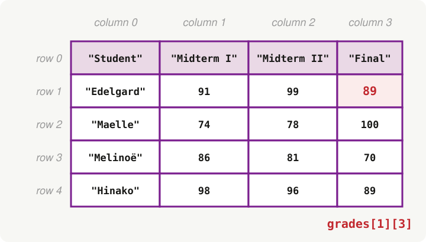
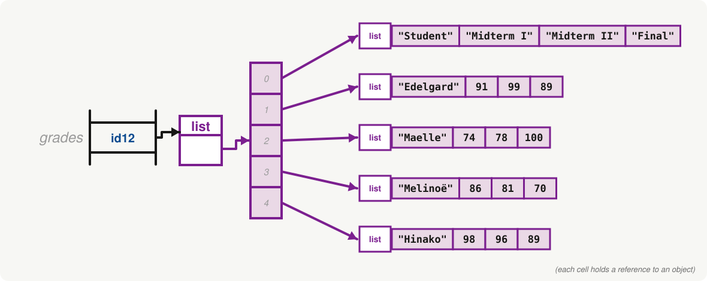
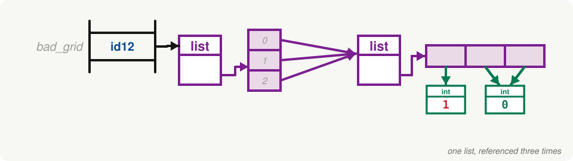
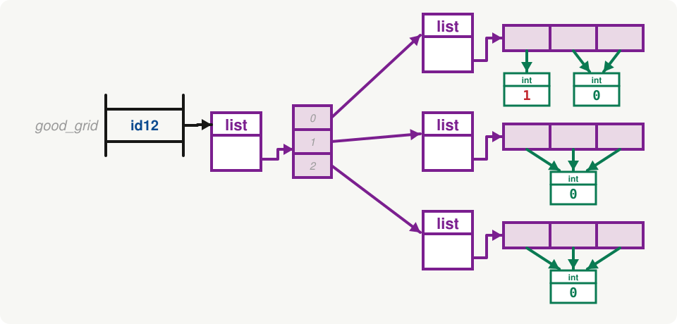

<h2 align=center>Lecture XVIII</h2>

<h1 align=center>Nested Lists and Tuples</h1>

<h3 align=center>20 de Brumaire, de l'Année CCXXXV de la République</h3>

***Song of the day:*** _[**Inspiration Comes and Goes, Record It Straight Onto My Phone**](https://youtu.be/0vBdpLXTDUs) by LambC / 램씨 (2025)._

### Sections

0. [**Lists Inside Lists**](#part-0-lists-inside-lists)
1. [**Indexing Nested Lists**](#part-1-indexing-nested-lists)
2. [**Traversing Nested Lists**](#part-2-traversing-nested-lists)
3. [**Building Nested Lists**](#part-3-building-nested-lists)
4. [**Tables From Files**](#part-4-tables-from-files)
5. [**Tuples In Tables**](#part-5-tuples-in-tables)
6. [**Practice Problems**](#part-6-practice-problems)

### Part 0: _Lists Inside Lists_

A list can hold any kind of object: integers, floats, strings, and, as it turns out, **other lists**. We have actually
already seen this once. In the last lecture, when we copied a list of class grades, every element of the outer list was
itself a list. Today we find out how to work with them on purpose.

A useful way to think about this is in terms of **dimensions**. A single piece of data, like the number `1`, has no
dimensions. A list of data points is a one-dimensional structure. And a list that holds other one-dimensional lists is,
therefore, a **two-dimensional** list (also known as a **matrix**):

```python
point = 1               # 0D
vector = [1, 2, 3]      # 1D
matrix = [
    [1, 2, 3],
    [4, 5, 6],
    [7, 8, 9]
]                       # 2D
```

Two-dimensional lists are how we store **tables** of data, and we run into tables everywhere. Here is a table of grades:

| Student  | Midterm I | Midterm II | Final |
|----------|-----------|------------|-------|
| Edelgard | 91        | 99         | 89    |
| Maelle   | 74        | 78         | 100   |
| Melinoë  | 86        | 81         | 70    |
| Hinako   | 98        | 96         | 89    |

Every **row** of the table becomes a list, and the table itself becomes a list of those rows
([**`nested_lists.py`**](nested_lists.py)):

```python
grades = [
    ["Student", "Midterm I", "Midterm II", "Final"],
    ["Edelgard", 91, 99, 89],
    ["Maelle", 74, 78, 100],
    ["Melinoë", 86, 81, 70],
    ["Hinako", 98, 96, 89]
]
```

(We could write all of it on a single line, but stacking the rows one on top of the other makes the code look like the
table that it represents. Python doesn't mind line breaks inside of brackets.)



<sub>**Figure 1**: Our `grades` list, drawn as a table. Rows and columns are numbered from `0`, just like every other
sequence that we have seen. The highlighted value is `grades[1][3]`.</sub>

### Part 1: _Indexing Nested Lists_

How many rows does our table have? The outer list has one element per row, so `len(grades)` tells us. And how many
columns? Each row is a list of its own, so we ask for the length of any one of them:

```python
print(len(grades))
print(len(grades[0]))
```

Output:

```text
5
4
```

To get a whole row, we index the outer list once. Since that gives us a list, we can index _that_ a second time to get a
single value out of the row. This is called **double indexing**:

```python
print(grades[1])
print(grades[1][3])
print(grades[0][2])
print(grades[2][0])
```

Output:

```text
['Edelgard', 91, 99, 89]
89
Midterm II
Maelle
```

Python reads `grades[1][3]` from left to right. First, `grades[1]` is evaluated, and it produces the row
`['Edelgard', 91, 99, 89]`. Then `[3]` is applied to that row. So the **first index chooses the row** and the
**second index chooses the column** (see **figure 1**).

Because the rows are lists, they can be changed with an assignment, just like any other list. Let's say that Maelle
turned out to have been owed a few points on her final:

```python
grades[2][3] = 95
print(grades[2])
```

Output:

```text
['Maelle', 74, 78, 95]
```

(For the rest of the lecture, let's pretend that never happened: Maelle's final grade is back to `100`.)

Slicing works on the outer list too, and, since the elements of the outer list are rows, it gives us **a list of rows**:

```python
print(grades[1:3])
```

Output:

```text
[['Edelgard', 91, 99, 89], ['Maelle', 74, 78, 95]]
```

That one is going to be handy in a moment: `grades[1:]` is our table _without_ its header row.

Now that we know about memory maps, here is what is really going on:



<sub>**Figure 2**: The `grades` list in memory. The outer list holds five **references**, one to each row, and every
row is a separate list object. The cells of the rows hold references to `str` and `int` objects.</sub>

There is no special "table" object in Python. There is only a list whose elements happen to be lists. This is also why
last lecture's warnings about copying apply here: copying the outer list copies the five references, but not the rows
that they refer to.

### Part 2: _Traversing Nested Lists_

To visit every value in a table, we need a loop **inside** of a loop: the outer one goes through the rows, and the inner
one goes through the values of the current row ([**`traversal.py`**](traversal.py)). Let's calculate the average of
every grade in our table. We want to skip the header row, and the first column (the names), so we will use slices:

```python
total = 0
count = 0

for row in grades[1:]:
    for grade in row[1:]:
        total += grade
        count += 1

print(f"The average grade of the class was {total / count:.2f}")
```

Output:

```text
The average grade of the class was 87.58
```

Just as with one-dimensional lists, we can instead loop through the **indices**. This time we need two of them, one for
the row and one for the column:

```python
total = 0
count = 0

for row_idx in range(1, len(grades)):
    for col_idx in range(1, len(grades[row_idx])):
        total += grades[row_idx][col_idx]
        count += 1

print(f"The average grade of the class was {total / count:.2f}")
```

Output:

```text
The average grade of the class was 87.58
```

Both versions do the same job, and our rule of thumb from the lists lecture still holds: if all you need is the **values**,
loop through the elements; if you also need to know **where** they are, loop through the indices.

Here are some examples of when the position matters. Let's start with one average **per student**, which is one average
for every _row_. We only need the values of each row, so looping through the elements is enough:

```python
for row in grades[1:]:
    total = 0
    for grade in row[1:]:
        total += grade

    print(f"{row[0]}: {total / (len(row) - 1):.2f}")
```

Output:

```text
Edelgard: 93.00
Maelle: 84.00
Melinoë: 79.00
Hinako: 94.33
```

Now one average **per exam**, which is one average for every _column_. This is a different story. Python gives us the
table row by row, so there is no way to loop through a column directly. We have to fix a column index, and then
visit that position in every row:

```python
for col_idx in range(1, len(grades[0])):
    total = 0
    for row_idx in range(1, len(grades)):
        total += grades[row_idx][col_idx]

    print(f"{grades[0][col_idx]}: {total / (len(grades) - 1):.2f}")
```

Output:

```text
Midterm I: 87.25
Midterm II: 88.50
Final: 87.00
```

Look at the order of the loops: the outer loop now goes through the **columns**, and the inner loop through the rows.
Which of the two goes on the outside is what decides whether we are processing the table row by row, or column by
column.

One last common task is **flattening** a table: turning a 2D list into a 1D list. Since we already know how to build a
list with `append()`, all we need is to append every value that we visit:

```python
all_grades = []

for row in grades[1:]:
    for grade in row[1:]:
        all_grades.append(grade)

print(all_grades)
```

Output:

```text
[91, 99, 89, 74, 78, 100, 86, 81, 70, 98, 96, 89]
```

### Part 3: _Building Nested Lists_

So far, we have typed our tables by hand. What if we want a table with 5 rows and 5 columns of random floats? We build it
the same way we build any other list: start with an empty one, and `append()` to it. The only difference is that what
we append to the table are **rows**, and each row is a list that has to be built first
([**`building.py`**](building.py)):

```python
from random import uniform

LO, HI = 0.0, 10.0
SIZE = 5

data = []

for row_num in range(SIZE):
    row = []
    for col_num in range(SIZE):
        row.append(round(uniform(LO, HI), 1))

    data.append(row)

print(data)
```

Output (yours will be different, of course):

```text
[[0.1, 0.1, 1.2, 0.6, 5.2], [7.3, 9.8, 0.3, 1.5, 9.7], [3.3, 2.4, 8.3, 5.7, 1.8], [7.7, 2.0, 6.2, 9.4, 7.3], [9.7, 1.3, 2.8, 9.2, 1.4]]
```

Notice where `row = []` lives: **inside** of the outer loop, so that a brand new, empty row is created on every pass.
That detail matters more than it looks, and it brings us to a very common mistake.

Python lets us **repeat** a list by multiplying it by an integer. This is a handy way to create a row of a given length:

```python
print([0] * 3)
```

Output:

```text
[0, 0, 0]
```

So, to create a 3 &times; 3 grid of zeros, why not just multiply a row by 3 as well?

```python
bad_grid = [[0] * 3] * 3
bad_grid[0][0] = 1
print(bad_grid)
```

Output:

```text
[[1, 0, 0], [1, 0, 0], [1, 0, 0]]
```

We only changed one value, and **three** of them changed. If this looks familiar, it should: this is aliasing again.
The `* 3` does not create three rows. It creates one row, and then puts three **references** to that same row in the
outer list:



<sub>**Figure 3**: `bad_grid = [[0] * 3] * 3`, after `bad_grid[0][0] = 1`. There is only one row, so changing it through
any of the three cells changes it for all of them.</sub>

The fix is to make sure that every row is a different list. We can do that with the loop that we already know, creating a
new row on every pass:

```python
good_grid = []

for row_num in range(3):
    good_grid.append([0] * 3)

good_grid[0][0] = 1
print(good_grid)
```

Output:

```text
[[1, 0, 0], [0, 0, 0], [0, 0, 0]]
```



<sub>**Figure 4**: `good_grid`, after `good_grid[0][0] = 1`. Each pass of the loop evaluated `[0] * 3` again, which
created a new row every time.</sub>

(Repeating the _row_ with `[0] * 3` is fine, by the way. The row only holds references to integers, and integers can't be
changed in place. It is repeating a list that holds **other lists** that causes trouble.)

### Part 4: _Tables From Files_

The tables that you will deal with in practice are not typed by hand, or filled with random numbers. They come from
files. Back in the lists lecture we read a CSV file one line at a time, and used `split()` to break each line up into a
list of values. Well, a CSV file **is** a table: every line is a row, and every comma-separated value is a column. So if
we put each of those lists into a bigger list, we get a 2D list. Take [**`grades.csv`**](grades.csv):

```text
Student,Midterm I,Midterm II,Final
Edelgard,91,99,89
Maelle,74,78,100
Melinoë,86,81,70
Hinako,98,96,89
```

Let's write a function that reads it ([**`grades_file.py`**](grades_file.py)). There are two things to take care of.
First, `split()` gives us **strings**, and we want the grades to be numbers so that we can do arithmetic with them. We
will keep the name as a string, and cast everything else with `int()`. Second, the first line is not data; it is the
header, so we will keep it apart from the rows:

```python
def read_grades(filepath):
    """Returns the header (a list of strings) and the rows (a list of lists) of a grades file."""
    header = []
    rows = []

    try:
        with open(filepath, 'r') as grades_file:
            header = grades_file.readline().strip().split(',')

            for line in grades_file:
                name, midterm_1, midterm_2, final = line.strip().split(',')

                # The name stays a string, and the grades become numbers
                rows.append([name, int(midterm_1), int(midterm_2), int(final)])
    except FileNotFoundError:
        print(f"ERROR: Could not open file '{filepath}'")

    return header, rows
```

Notice the line that reads `name, midterm_1, midterm_2, final = line.strip().split(',')`. The list that `split()`
returns has exactly four values, so we can **unpack** it into four variables at once, the same way that we unpacked a
tuple in lecture 16. Giving every value a name is a lot more readable than `pieces[0]`, `pieces[1]`, and so on, and
it lets us build the row, with the right types, in a single line at the end.

Did you notice the last line? `return header, rows` returns **two** values. Remember from the tuples section of lecture
16: Python packs them into a tuple, and we can unpack them into two variables right away:

```python
header, rows = read_grades("grades.csv")

print(header)
print(rows)
```

Output:

```text
['Student', 'Midterm I', 'Midterm II', 'Final']
[['Edelgard', 91, 99, 89], ['Maelle', 74, 78, 100], ['Melinoë', 86, 81, 70], ['Hinako', 98, 96, 89]]
```

And since `rows` is a 2D list without a header, all of the loops from Part 2 work on it with one small change: we no longer need the `[1:]`
that skipped the header row of `grades`.

We can also go in the other direction and **write** a table into a file. Back in the file output lecture, we saw that
`print()` can write into a file if we give it the `file` argument, and that its `sep` argument can be set to a comma.
Let's write a function that saves each student's average into a new CSV file:

```python
def write_averages(rows, report_filepath):
    with open(report_filepath, 'w') as report_file:
        print("Student,Average", file=report_file)

        for row in rows:
            total = 0
            for grade in row[1:]:
                total += grade

            print(row[0], round(total / (len(row) - 1), 1), sep=',', file=report_file)


write_averages(rows, "averages.csv")
```

Contents of `averages.csv`:

```text
Student,Average
Edelgard,93.0
Maelle,84.0
Melinoë,79.0
Hinako,94.3
```

### Part 5: _Tuples In Tables_

In our grade tables, every row is a list. But look at what a row **is**: one student's record, with a fixed number of
fields, always in the same order (name, midterm I, midterm II, final). Once we have read it from a file, we rarely want
to add, delete or reorder the fields of a record. That is exactly the kind of data that tuples are good for, as we
saw in lecture 16. So a table can also be a **list of tuples**.

Let's try it with a different file, [**`students.csv`**](students.csv):

```text
Name,Major,GPA,Credits
Emily,MechE,4.0,17
Reid,MechE,3.8,20
Hayden,Physics,3.9,22
Matt,MechE,4.0,25
Odanys,CivE,3.2,75
Cari,CivE,3.4,25
Jason,MechE,2.7,30
Ines,CBE,3.4,68
```

([**`tuples_in_tables.py`**](tuples_in_tables.py))

```python
def read_students(filepath):
    """Returns a list of (name, major, gpa, credits) tuples."""
    students = []

    try:
        with open(filepath, 'r') as students_file:
            students_file.readline()  # header

            for line in students_file:
                name, major, gpa, credits = line.strip().split(',')
                students.append((name, major, float(gpa), int(credits)))
    except FileNotFoundError:
        print(f"ERROR: Could not open file '{filepath}'")

    return students
```

This is the same unpacking idea as in `read_grades()`, with one new detail: the double parentheses in
`students.append((...))`. The outer pair belongs to `append()`; the inner pair builds the tuple that we are
appending.

```python
students = read_students("students.csv")

print(students[0])
print(students[0][2])
```

Output:

```text
('Emily', 'MechE', 4.0, 17)
4.0
```

Double indexing works exactly like it did with lists. And so does the loop, but tuples allow us to do something even
nicer. If every element of a list is a tuple of the same size, the loop variable can be **unpacked** right in the `for`
statement:

```python
for name, major, gpa, credits in students:
    print(f"{name} ({major}): {gpa} GPA, {credits} credits")
```

Output:

```text
Emily (MechE): 4.0 GPA, 17 credits
Reid (MechE): 3.8 GPA, 20 credits
Hayden (Physics): 3.9 GPA, 22 credits
Matt (MechE): 4.0 GPA, 25 credits
Odanys (CivE): 3.2 GPA, 75 credits
Cari (CivE): 3.4 GPA, 25 credits
Jason (MechE): 2.7 GPA, 30 credits
Ines (CBE): 3.4 GPA, 68 credits
```

Compare that with `student[0]`, `student[1]`, and so on: each field now has a name that says what it is.

Of course, there is a price to pay. The outer list is still a list, so we can replace a whole row. But a row is a tuple
now, so we can't change a single value inside of it:

```python
students[0] = ("Emily", "MechE", 3.9, 17)  # fine: we replaced the whole tuple
students[0][2] = 4.0                       # TypeError: 'tuple' object does not support item assignment
```

Whether that is a feature or an annoyance depends on the data. For a record that should never change by accident, it is
a feature. For a table that you plan to edit cell by cell, use lists.

Tuples are also the natural way to talk about **positions** in a table. Let's write a function that looks for a value
in a table, and returns where it found it as a `(row, column)` pair, or `None` if it isn't there at all:

```python
def find_value(table, target):
    """Returns the (row, column) position of the first occurrence of target, or None if it is not there."""
    for row_idx in range(len(table)):
        for col_idx in range(len(table[row_idx])):
            if table[row_idx][col_idx] == target:
                return (row_idx, col_idx)

    return None
```

Notice that this is one of those cases where we need the indices, not only the values. Using our `grades` table
from the start of the lecture:

```python
print(find_value(grades, 100))

row, col = find_value(grades, "Hinako")
print(f"Found at row {row}, column {col}")

print(find_value(grades, 55))
```

Output:

```text
(2, 3)
Found at row 4, column 0
None
```

One last thing before we move on. Tuples being immutable gives them another power that lists don't have: a tuple can be
used as a **dictionary key**, but a list can't. We will find out what that means, and why it is so useful, in the next
lecture.

### Part 6: _Practice Problems_

**Problem 1**: Create a 2D list of random floats between `0.0` and `10.0`, with 5 rows and 5 columns. Use loops to build
the first row (five floats in a list), and then add that row to the main list. Do this five times. When the table is
done, loop through it, and calculate and print the average of all of its values.

**Problem 2**: Extend problem 1 so that the number of rows and the number of columns are each a random integer between
`8` and `25`. The table should still be a rectangle (every row has the same number of elements), but its size is now
random.

**Problem 3**: Using [**`students.csv`**](students.csv), write a function that reads it into a list of tuples (like we
did in Part 5), and then two more functions that determine:

- How many students, and which ones, have a GPA greater than `3.5`?
- How many students, and which ones, have more than `32` credits?

**Problem 4**: Write a function called `get_column()` that accepts a table (a list of lists) and a column index, and
returns a **list** with the value at that position in every row. Then use it, and `max()`, to find the highest final
grade in the following table, and use `find_value()` from Part 5 to print the name of the student who earned it:

```python
grades = [
    ["Edelgard", 91, 99, 89],
    ["Maelle", 74, 78, 100],
    ["Melinoë", 86, 81, 70],
    ["Hinako", 98, 96, 89]
]
```

Solutions: [**problem 1**](solutions/random_grid.py), [**problem 2**](solutions/random_grid_sized.py),
[**problem 3**](solutions/students_report.py), and [**problem 4**](solutions/column_tools.py) (in the
[**`solutions`**](solutions) sub-folder).

<sub>**Previous: [Copying Lists and Memory Maps](/lectures/17-memory-maps/)** | **Next: [Python Dictionaries](/lectures/19-dictionaries/)**</sub>
