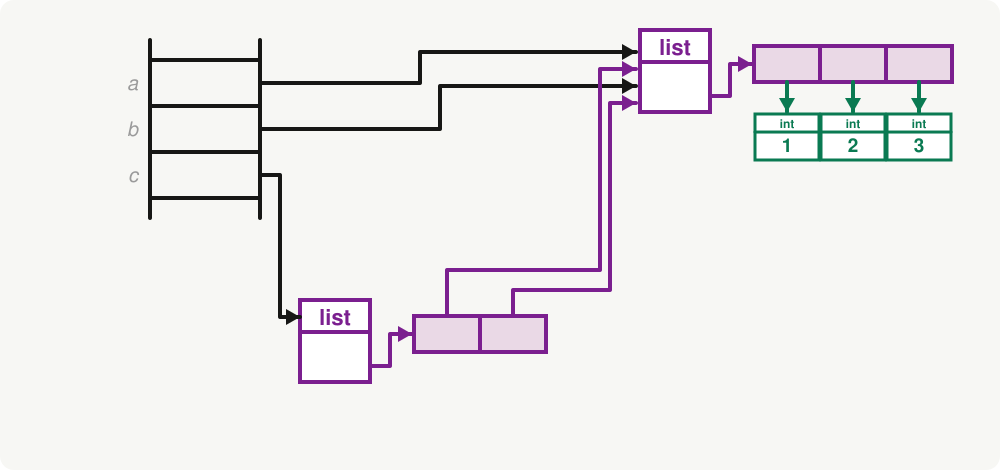

<h2 align=center>Review Solutions</h2>

<h1 align=center>Midterm 2: Lists, Tuples, Exceptions, and Memory</h1>

### 1. Lists and Tuples

**(a)** 

```text
None
[72, 88, 95]
```

`sort()` changes the list that it was called on, and **returns `None`**. So `ordered` is `None`, and `marks` is the list
that was sorted.

**(b)** `[90, 100, 100] [90, 100]`

`add_bonus` builds a **new** list with `+` and assigns it to its own parameter, so `grades` is not affected, and `result`
holds the new list. `add_bonus_inplace` calls `append()` on the list that it received, which is `grades` itself, so
`grades` changes each of the two times that it is called.

**(c)** `ERROR`

A tuple cannot have its elements reassigned, so `record[1] = [100]` is a `TypeError`. The line above it is fine: the
tuple holds a reference to a list, and the **list** can be changed. The error happens before the `print`, so nothing is
printed.

**(d)** `['b', 'd'] ['f', 'd', 'b'] ['d', 'e', 'f']`

`letters[1:5:2]` takes indices `1` and `3`. `letters[::-2]` starts from the end and goes back two at a time: indices `5`,
`3`, `1`. `letters[-3:]` is the last three elements.

### 2. Exceptions

**(a)** `done done 3.0 -1`

Python has to evaluate both calls **before** it can print anything. Each call runs its `finally` block, even though the
function returns, so `done ` is printed twice, first. Only then does `print(3.0, -1)` run.

**(b)** `ERROR`

On the second element, `2 + "3"` is a `TypeError`. The only `except` is for `ValueError`, so nothing catches it, and the
program crashes before it reaches the last `print`.

**(c)** `3 zero text end`

| `text` | what happens                           | prints  |
|--------|----------------------------------------|---------|
| `"8"`  | `24 // 8` is `3`, no exception: `else` | `3 `    |
| `"0"`  | `ZeroDivisionError`                    | `zero ` |
| `"-"`  | `int("-")` is a `ValueError`           | `text ` |

**(d)** `5 bad 7 `

`raise` stops `check()` right away, and the `ValueError` is caught by the `except` in the loop. The `print` was never
reached for `-2`, because `check(-2)` raised before it returned a value.

### 3. Aliases and Copies

| **Statements**                                                                     | **Output**         | **Why**                                                                                                                  |
|------------------------------------------------------------------------------------|--------------------|--------------------------------------------------------------------------------------------------------------------------|
| `alias.append(["Cy", 70])`<br>`print(len(team), len(shallow))`                     | `3 2`              | `alias` is the same list as `team`, so it grows. `shallow` is a different outer list.                                    |
| `shallow[0][1] = 95`<br>`print(team[0][1], deep[0][1])`                            | `95 90`            | `shallow[0]` is the **same inner list** as `team[0]`. `deep` has its own inner lists.                                    |
| `team[1][0] = "Bob"`<br>`print(shallow[1][0], deep[1][0])`                         | `Bob Bo`           | `shallow[1]` is the same inner list as `team[1]`, so it sees the change. `deep[1]` is a separate list, so it does not.   |

### 4. Memory Maps



There are **two** list objects: the list that `a` and `b` refer to, and the list that `c` refers to. `c`'s two cells hold
a reference to the **same** list, and `b.append(3)` changed that list, so `print(c)` shows `[[1, 2, 3], [1, 2, 3]]`.
